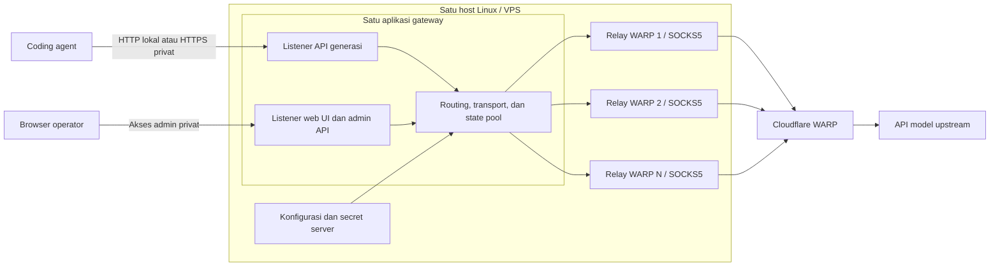
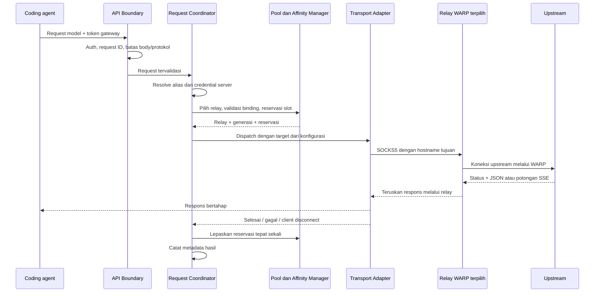
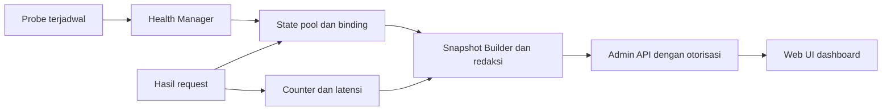

# ARCHITECTURE opencode-infinity

Versi: 0.1.4  
Tanggal: 23 November 2026  
Status: Draft arsitektur MVP; belum disetujui  
Acuan kebutuhan: [PRD 0.1.13](PRD.md)  
Referensi utama: [warp-relay-pool](https://github.com/trefeon/warp-relay-pool)

opencode-infinity menggunakan **satu aplikasi gateway dengan modul internal yang terpisah tanggung jawabnya, web UI dashboard pada aplikasi yang sama, dan pool relay WARP di container terpisah**. Gateway mengelola request serta state operasional; setiap relay menyediakan jalur SOCKS5 menuju upstream. Dashboard membaca kondisi yang dipakai gateway untuk mengambil keputusan routing.

Urutan perancangan adalah **PRD → ARCHITECTURE → TECHSTACK → implementasi**. Arsitektur menetapkan batas komponen, alur, kepemilikan state, dan perilaku gagal. Bahasa, framework, library, serta base image dipilih setelah rancangan ini divalidasi. [TECHSTACK](TECHSTACK.md) berisi kandidat implementasi; [catatan teknis](PRD-technical-notes.md) mempertahankan kontrak dan skenario penerimaan awal.

Kebutuhan gateway, pool WARP, dan web UI berasal dari PRD serta arahan pengguna. Keputusan arsitektur dan penjabaran yang belum ditetapkan PRD merupakan usulan **(agent's call)**. Dokumen ini tidak mengubah cakupan MVP/P1 atau menyatakan adanya implementasi dan hasil benchmark.

## 1. Keputusan arsitektur utama

| ID | Keputusan rancangan | Alasan dan konsekuensi |
|---|---|---|
| A-1 | Gateway berupa modular monolith dalam satu proses | Komunikasi antarmodul berada di memory; deployment tetap satu aplikasi pada satu host |
| A-2 | Jalur generasi dan jalur admin memakai listener terpisah | Token agent hanya memberi akses API model; dashboard dan operasi admin memiliki batas akses sendiri |
| A-3 | Gateway memakai SOCKS5 tiap relay secara langsung | Sesuai MVP; protokol relay HTTP referensi tetap menjadi integrasi P1 |
| A-4 | Pemilihan relay, binding, dan reservasi kapasitas dikoordinasikan secara atomik | Request serentak tidak dapat memakai slot yang sama atau membuat binding yang bertentangan |
| A-5 | Dashboard membaca snapshot dari state operasional gateway | Status UI dan keputusan router berasal dari sumber yang sama |
| A-6 | Aset web UI disajikan bersama gateway | Satu origin admin dan satu artefak aplikasi; framework UI tidak menentukan arsitektur layanan |
| A-7 | Konfigurasi dan profil WARP persisten; state runtime bersifat sementara dan dibatasi | Restart memiliki konsekuensi eksplisit terhadap health, binding, counter, dan sesi admin |
| A-8 | Operator mengelola lifecycle container WARP pada MVP | Gateway tidak memegang Docker socket; controller otomatis tetap P1 |

Semua keputusan A-1–A-8 berstatus usulan arsitektur **(agent's call)** dan harus memenuhi syarat penerimaan PRD.

## 2. Konteks sistem dan batas deployment



MVP memakai satu container aplikasi dan satu container per relay. Angka listener awal dari catatan teknis adalah API 8787 dan admin 8788; nilai tersebut masih usulan yang dapat dikonfigurasi. Akses host dipublikasikan ke loopback secara default; akses remote mengikuti jaringan privat dan perlindungan transport deployment.

Gateway dan WARP berkomunikasi melalui jaringan container yang sama atau jaringan bersama dengan pool yang sudah ada. Alamat relay berada di konfigurasi server. Gateway tidak menganggap jumlah container sebagai jumlah alamat IP unik, dan tidak menggunakan jaringan internet langsung sebagai fallback ketika relay gagal.

[D-001–D-003](DECISIONS.md) menetapkan penggunaan awal pribadi pada container lokal atau homelab, dengan akses homelab melalui Tailscale yang disiapkan pengguna. [D-006](DECISIONS.md) menetapkan host uji Linux x86_64/amd64, Docker Compose, Tailscale di host, dan `tailscale serve` sebagai jalur HTTPS; listener final, hostname tailnet, dan detail sertifikat belum dipilih. Kebutuhan siap container tidak menyiratkan penyediaan homelab atau Tailscale otomatis oleh aplikasi.

## 3. Modul dan kepemilikan tanggung jawab

Modul berikut adalah bagian dari aplikasi yang sama, bukan service/container terpisah.

| Modul | Tanggung jawab | Batas tanggung jawab |
|---|---|---|
| Configuration Registry | Memuat dan memvalidasi upstream, alias model, relay, credential, serta kebijakan | Perubahan konfigurasi melalui restart pada MVP; client tidak menetapkan target upstream |
| API Boundary | Autentikasi token gateway, request ID, validasi ukuran/protokol, serta error sebelum stream | Tidak memberi akses admin dan tidak menjalankan tool agent |
| Request Coordinator | Mengatur lifecycle request dari admission sampai pelepasan resource | Satu penyelesaian request harus melepaskan slot tepat sekali |
| Pool Manager | Memiliki state relay, eligibility, mode operasi, dan reservasi kapasitas | Keputusan tidak diserahkan ke browser atau skrip eksternal |
| Affinity Manager | Menjaga binding token/upstream/model/session ke relay dan generasi | Tidak menebak sesi dari prompt; perubahan identitas tidak diikuti rebinding diam-diam |
| Transport Adapter | Membuka jalur SOCKS5, TLS upstream, dan meneruskan respons dengan backpressure | Tidak mengganti upstream/model/credential atau menentukan retry bisnis sendiri |
| Health Manager | Menjalankan probe terbatas dan menghasilkan observasi kesehatan/identitas | Probe tidak membuktikan semua model dapat digunakan; generasi berbayar tidak diprobe otomatis |
| Admin Boundary | Otorisasi dashboard, status, metrik, dan perintah operasional terkontrol | Tidak memberikan akses Docker atau proxy bebas |
| Snapshot Builder | Membentuk tampilan status teredaksi dari state dan metrik | Tidak melakukan probe baru atau request upstream setiap kali dashboard dimuat |
| Telemetry | Mencatat metadata hasil, counter, dan latensi | Tidak menyimpan prompt, respons, secret, atau raw session ID |
| Web UI | Menampilkan snapshot, kesegaran data, dan kondisi kegagalan pembaruan | Tidak menjadi sumber kebenaran routing atau pemilik credential upstream |

Health Manager menghasilkan observasi; Pool Manager menerapkan perubahan state. Request Coordinator meminta pemilihan relay dan reservasi kepada Pool Manager bersama Affinity Manager. Pemeriksaan kapasitas, pembentukan binding baru, dan reservasi harus menjadi satu keputusan yang konsisten sebelum dispatch.

## 4. Jalur request generasi



Urutan admission memastikan request yang gagal autentikasi, validasi, atau kapasitas tidak dikirim ke upstream. Alias menentukan upstream dan model sebenarnya; credential upstream berasal dari server. Default upstream dan provider spesifik masuk ke jalur internal yang sama agar perilakunya konsisten.

Request hanya diubah untuk pemetaan model dan header autentikasi/transport yang diperlukan. Field tambahan yang didukung upstream dipertahankan. Respons JSON/SSE, termasuk tool-call deltas, diteruskan tanpa mengumpulkan seluruh stream atau menyatukan hasil dari generasi lain.

Resolusi hostname upstream dilakukan melalui SOCKS5; resolusi alamat container relay adalah kebutuhan jaringan internal yang terpisah. TLS memverifikasi hostname upstream. Redirect tidak diikuti dan tidak boleh meneruskan credential ke tujuan lain.

Slot request global dipegang selama lifecycle request; slot relay dipegang selama attempt/stream terkait. Jika fallback yang sah terjadi, reservasi relay lama dilepas sebelum reservasi penggantinya digunakan, sementara request global tetap sama. EOF, timeout, error, dan disconnect memakai jalur penyelesaian yang menjamin pelepasan resource tepat sekali.

## 5. Routing, affinity, dan state relay

### Eligibility dan kapasitas

Relay dapat menerima assignment jika terdaftar untuk mapping yang diminta, mode operasinya menerima trafik, transportnya layak, cooldown pada scope terkait tidak memblokir, kapasitas tersedia, dan aturan affinity terpenuhi. Pemeriksaan serta reservasi dilakukan atomik; membaca snapshot lalu menambah counter secara terpisah tidak cukup.

Fixed routing tetap default. Least-inflight hanya berlaku pada model stateless yang telah divalidasi. Strict affinity tidak digabung dengan least-inflight. Batas konkurensi berlaku untuk request aktif sampai stream selesai, bukan hanya sampai header diterima. Antrean tanpa batas tidak menjadi mekanisme penanganan overload; kapasitas yang habis menghasilkan penolakan sesuai kontrak PRD.

### Dimensi state

| Dimensi | Pemilik | Arti |
|---|---|---|
| Kesehatan transport | Pool Manager, dari observasi Health Manager | Checking, healthy, atau unhealthy; tidak menyatakan semua upstream/model sehat |
| Mode operasional | Pool Manager, dari tindakan admin | Serving, draining, atau disabled; terpisah dari hasil probe |
| Kapasitas | Pool Manager, dari reservasi request | Slot aktif dan batas gateway/relay |
| Cooldown | Pool Manager, dari hasil request/probe yang relevan | Berlaku pada scope relay, upstream, model, atau credential sesuai bukti |
| Generasi identitas | Pool Manager, melalui prosedur maintenance/invalidation | Membedakan penggunaan identitas relay sebelum dan sesudah perubahan yang diketahui |
| Binding percakapan | Affinity Manager | Token, upstream, model, dan sesi terikat ke relay/generasi |

Pemisahan dimensi di atas adalah penjabaran arsitektur **(agent's call)**. State ringkas yang ditampilkan tetap dapat berupa checking/healthy/unhealthy/draining/disabled sebagaimana catatan awal, disertai alasan eligibility. Hasil probe sukses tidak mengaktifkan relay yang masih di-drain atau disabled.

### Aturan affinity

Binding eksplisit mengikuti identitas token, upstream, model, dan session ID. Jika identitas yang dibutuhkan binding tidak dapat dipertahankan, request gagal secara eksplisit; router tidak membuat binding pengganti secara diam-diam. Jumlah binding dan TTL dibatasi, dan binding aktif tidak digusur untuk menerima sesi baru.

Tanpa sinyal sesi eksplisit, fixed routing hanya memberi kestabilan jalur bersama pada scope mapping dan lifetime proses. Ia tidak memberikan isolasi percakapan atau deteksi sesi lama setelah restart. Kontrak awal pembentukan sesi pada catatan teknis harus divalidasi dengan client yang dipilih; D-013 menetapkan MVP tidak mengklaim strict affinity untuk client nyata, sedangkan lifecycle strict dibuktikan lewat fixture dan dukungan client menunggu C-15.

Generasi identitas adalah state yang diketahui gateway, bukan bukti bahwa setiap perubahan IP atau restart eksternal dapat dideteksi. Maintenance terkontrol harus memberi gateway kesempatan menonaktifkan assignment, membatalkan binding bila disetujui operator, dan memperbarui generasi sebelum trafik dibuka. Model yang memerlukan identitas jaringan absolut dinyatakan tidak kompatibel bila persyaratannya tidak dapat dibuktikan.

## 6. Penanganan kegagalan

| Kondisi | Keputusan arsitektur |
|---|---|
| Kapasitas gateway/binding habis | Tolak sebelum dispatch; tidak membentuk antrean tanpa batas |
| Non-strict gagal sebelum request dapat terkirim dan bukti tersedia | Boleh satu fallback; maksimal dua attempt total sesuai PRD |
| Status pengiriman ambigu | Hentikan request dengan error; tidak mengulang generasi otomatis |
| JSON/SSE sudah mulai diteruskan | Tidak failover; tangani stream yang putus tanpa penanda sukses palsu |
| Strict binding hilang/tidak valid | Error affinity; tidak mengganti relay atau generasi |
| Upstream menolak auth/akses atau request | Pertahankan error upstream; tidak merotasi relay untuk menyamarkan penyebab |
| Upstream 429 | Teruskan Retry-After yang valid; terapkan cooldown konservatif sesuai scope; tanpa restart WARP otomatis |
| Semua relay tidak eligible | Error tidak tersedia; tidak ada jalur langsung ke internet |
| Client disconnect | Batalkan pekerjaan upstream, tutup stream terkait, dan lepaskan resource |
| Sumber status dashboard tidak dapat dihubungi | Tampilkan kegagalan pembaruan dan waktu data terakhir; bukan status sehat baru |

Transport Adapter melaporkan bukti fase pengiriman kepada Request Coordinator. Jika implementasi transport tidak bisa membuktikan request belum terkirim, MVP memakai satu attempt. Kebijakan retry library, client, dan gateway harus diperhitungkan bersama; kegagalan observabilitas tidak memberi izin untuk mengulang generasi.

Error gateway sebelum stream memakai format seragam dan request ID. Setelah stream dimulai, status HTTP tidak dapat diganti; kegagalan dicatat dan koneksi ditangani sesuai kontrak stream yang didukung. Error upstream tetap dapat dibedakan dari error yang dibuat gateway.

## 7. Jalur monitoring dan dashboard



Health Manager menjalankan probe ringan dengan batas paralelisme, timeout, jitter, dan backoff. Empat lapisan tetap dibedakan: proses gateway, keterjangkauan SOCKS5, jalur HTTPS keluar, serta ketersediaan upstream/model. IP teramati mencatat tujuan dan waktu probe; alamat yang sama atau IPv6 yang tidak tersedia ditampilkan tanpa asumsi kerusakan relay.

Snapshot menggabungkan state yang diperlukan C-9/C-14: ringkasan pool, relay/generasi, mode dan kesehatan, inflight/kapasitas, cooldown, alasan gangguan, observasi IP, serta metadata waktu. Pembacaan snapshot tidak menahan jalur dispatch selama serialisasi atau pengiriman ke browser. Payload dan biaya pembacaan dibatasi sesuai kapasitas deployment.

Web UI melakukan pembaruan otomatis dari admin API melalui polling 5 detik dengan ambang stale 15 detik (D-009); push SSE/WebSocket ditunda ke P1. Waktu snapshot, probe relay, dan pembaruan browser dibedakan agar pembaruan UI tidak dianggap sebagai probe baru. Membuka banyak tab tidak boleh menjalankan banyak probe upstream.

Dashboard hanya menampilkan metadata operasional. Credential, token, prompt/response, body tool, serta raw session ID tidak masuk ke snapshot. Fitur maintenance tetap tersedia melalui prosedur admin C-7; kontrol lifecycle container melalui UI tidak ditambahkan ke kebutuhan pemantauan C-14.

## 8. Data dan batas resource

| Data | Lokasi/lifetime | Perilaku setelah restart |
|---|---|---|
| Konfigurasi upstream/model/relay dan kebijakan | File konfigurasi server, persisten | Divalidasi ulang sebelum trafik diterima |
| Secret gateway/admin/upstream | Environment atau file secret server | Dimuat ulang; tidak masuk respons status |
| Profil WARP | Volume privat tiap relay | Dipertahankan sesuai lifecycle relay |
| Health, cooldown, inflight, binding | Memory gateway dengan batas kapasitas | Dibangun ulang; binding strict lama tidak dianggap valid secara diam-diam |
| Sesi autentikasi dashboard | State runtime admin jika memakai sesi server | Tidak diasumsikan bertahan; perilaku login ulang ditetapkan pada desain auth |
| Counter dan ringkasan latensi | Memory gateway | Reset dikenali melalui identitas/waktu mulai proses |
| Log metadata | Output proses dengan retensi oleh operator | Mengikuti kebijakan log deployment |
| Prompt, respons, dan riwayat percakapan | Hanya transit selama request | Tidak dipersistensikan oleh gateway |

Batas resource mencakup ukuran body, total buffer yang sedang dipakai, request aktif, koneksi, binding, sesi admin, pekerjaan probe, dan pembacaan status. Batas body per request saja tidak cukup untuk mengendalikan total memori ketika banyak client mengirim body besar. Admission harus memperhitungkan anggaran buffer dan melepaskan resource pada kegagalan validasi atau pembatalan.

Stream menggunakan buffer terbatas dan backpressure ke upstream. Pengiriman log/metrik juga dibatasi agar exporter atau dashboard yang lambat tidak menahan stream. Database, broker pesan, atau cache terdistribusi tidak menjadi dependensi arsitektur MVP satu proses ini.

Target PRD tetap: overhead p95 tambahan ≤50 ms dan RSS gateway ≤256 MiB pada 20 stream selama 30 menit di host uji 2 vCPU/2 GiB. Angka tersebut adalah target usulan, bukan hasil pengukuran. Benchmark harus memasukkan dashboard aktif dan kapasitas relay yang memadai, serta melaporkan WARP dan konsumsi total host secara terpisah.

## 9. Batas kepercayaan dan akses

| Batas | Aturan |
|---|---|
| Client → API generasi | Token gateway, validasi ukuran/protokol/model; tidak menerima target origin bebas |
| Browser/operator → admin | Otorisasi admin tersendiri; akses lokal atau privat; lifecycle sesi dan perlindungan request browser ditetapkan sebelum rilis |
| API generasi → admin | Token generasi tidak memberikan hak membaca status admin atau mengubah state |
| Gateway → upstream | Credential server menggantikan token client; HTTPS dan hostname tervalidasi; redirect tidak diikuti |
| Gateway → relay | Target SOCKS5 dari konfigurasi; jaringan container hanya untuk komponen tepercaya |
| Gateway → host container runtime | Gateway tanpa Docker socket atau privilege pengelolaan jaringan |
| Relay WARP → host | Izin jaringan dibatasi pada container relay sesuai kebutuhan image yang diuji |

Operator gateway berada dalam trust boundary yang dapat membaca konten saat pemrosesan. Isolasi token dan binding bukan isolasi tenant penuh. Snapshot, log, metrik, dan error menerapkan redaksi di server sebelum dikirim ke konsumen.

## 10. Startup, drain, maintenance, dan shutdown

1. **Startup:** validasi konfigurasi/secret, bangun registry dan state awal, lalu mulai health check. Relay belum dianggap sehat hanya karena proses container hidup. Readiness membedakan kesiapan konfigurasi dan relay; tidak menjanjikan semua model dapat digunakan.
2. **Drain relay:** ubah mode agar tidak menerima reservasi baru, termasuk assignment baru untuk sesi yang terikat. Request yang sudah di-admit tetap ditangani sampai selesai atau mengalami kegagalan normal. Deadline menampilkan pekerjaan yang belum selesai; tidak memberi izin penghentian paksa diam-diam.
3. **Maintenance identitas:** operator memeriksa inflight dan binding aktif. Tidak ada stream aktif belum berarti tidak ada binding. Restart/rekey dilakukan setelah syarat maintenance terpenuhi atau pembatalan binding disetujui secara eksplisit; generasi diperbarui dan health diperiksa sebelum trafik dibuka.
4. **Shutdown gateway:** hentikan admission baru, tandai readiness tidak siap, dan drain request yang berjalan. Sesuai D-014, deadline drain 60 detik hanya menolak admission baru; stream yang sudah di-admit berlanjut sampai batas keras 30 menit. Bila batas tercapai, gateway mencatat stream/binding yang diputus lalu keluar dengan exit code eksplisit, dan `stop_grace_period` container disetel lebih besar dari batas tersebut. Dokumen ini tidak menganggap deadline sebagai bukti seluruh stream pasti selesai.
5. **Restart:** state sementara dibangun ulang, health diperiksa kembali, dan sesi lama diperlakukan sesuai kontrak restart. Konfigurasi baru tidak diterapkan sebagian pada proses yang masih melayani trafik.

Gangguan relay tidak mematikan proses gateway atau stream pada relay lain. Satu proses gateway tetap menjadi titik kegagalan bersama yang diterima pada cakupan satu host; high availability lintas proses/host tidak ditambahkan ke MVP.

## 11. Hubungan dengan referensi dan pengembangan berikutnya

Konsep pool WARP, SOCKS5 per relay, dan pemisahan jalur terinspirasi dari [warp-relay-pool](https://github.com/trefeon/warp-relay-pool). Jalur relay proyek asal dijelaskan dalam [overview referensi](https://github.com/trefeon/warp-relay-pool/blob/main/docs/01-overview-how-it-works.md). Referensi tidak menetapkan otomatis kebijakan retry, auth, rotasi, atau ingress opencode-infinity.

MVP mengadopsi batas protokol SOCKS5 dan kontrak gateway sendiri. Adapter protokol header relay HTTP, Responses API, controller maintenance, plugin sesi dinamis, serta export konfigurasi/secret store tetap P1. Penambahan kelak harus mempertahankan aturan dispatch, affinity, dan sumber state yang sama. Detail framework, library, dan versi tetap berada di TECHSTACK.

## 12. Keterlacakan dan keputusan tersisa

| Area arsitektur | Kapabilitas PRD | Bukti penerimaan |
|---|---|---|
| Kontrak API dan alur respons | C-1, C-2, C-3 | AC-01–AC-04 |
| Transport SOCKS5 dan target upstream | C-4, C-8 | AC-05–AC-06, AC-11, AC-16 |
| Routing, cooldown, dan retry | C-4, C-5 | AC-07–AC-09 |
| Auth dan pemisahan credential | C-8 | AC-10 |
| Affinity dan restart | C-6 | AC-13–AC-14 |
| Pembatalan, drain, dan kapasitas | C-4, C-7 | AC-12, AC-15, AC-18 |
| Identitas jaringan dan diagnosis | C-9 | AC-17 |
| Target resource dan paket deployment | C-10 | AC-19 |
| Monitoring melalui browser | C-9, C-14 | AC-20–AC-22 |

Validasi arsitektur mengikuti gerbang M0–M3 pada PRD. Prioritas sebelum menetapkan stack adalah membuktikan batas transport, buffering, cancellation, retry, serta pembacaan status tanpa mengganggu jalur generasi. Pengujian fixture tidak menggantikan integrasi OpenCode CLI/Desktop dan WARP nyata.

| Keputusan tersisa | Acuan | Pemilik usulan | Batas keputusan |
|---|---|---|---|
| Host/arsitektur CPU dan batas deployment | O-2 | Pengguna/operator; D-006 | Listener final dan tailnet sebelum M0 selesai |
| Upstream/model serta client/protokol yang diuji | O-3 | Pengguna + agent; D-007 | Provider/model dan versi Desktop dicatat saat M0 |
| Lifecycle sesi strict dan deteksi lanjutan setelah restart | O-4 | Pengguna + agent; D-013 | Skema/TTL fixture sebelum M2.2 ditutup |
| Shutdown, deadline drain, dan termination container | O-5 | Pengguna; D-014 | Nilai grace period dan exit code pada EP-04-T05 |
| Anggaran buffer/koneksi/state dan kapasitas benchmark | O-6 | Pengguna + agent; D-008 | Default timeout/probe sebelum M3 |
| Target kesegaran dashboard | O-10 | Pengguna; D-009 | Polling 5 detik/stale 15 detik ditetapkan; target P1 push belum |
| Kontrak auth browser, TTL sesi, dan mekanisme pembaruan UI | Penjabaran A-2/A-5/A-7 | Tim implementasi, TBD | Sebelum uji AC-21–AC-22 |

Sesudah keputusan arsitektur divalidasi, kandidat pada [TECHSTACK](TECHSTACK.md) dipetakan ke modul di atas dan diuji terhadap gerbang yang sama. Pilihan teknologi tidak boleh mengubah cakupan produk atau melonggarkan aturan kegagalan untuk menyesuaikan default library.

## 13. Struktur project yang disarankan

Struktur disusun berdasarkan tanggung jawab modul pada bagian 3. Contoh konkret berikut memakai kandidat Go dan Svelte pada TECHSTACK **(agent's call)**. Pilihan stack tetap mengikuti M0; batas state, transport, API, dan UI dipertahankan jika kandidat berubah.

Satu repository memuat satu modul backend dan satu project frontend. Entrypoint aplikasi berada di `cmd/`, logika server di `internal/`, dan source UI di `web/`. Penempatan kode server pada `internal/` serta command pada `cmd/` mengikuti [pedoman organisasi modul Go](https://go.dev/doc/modules/layout#server-project).

### 13.1 Susunan folder MVP

```text
opencode-infinity/
├── cmd/
│   └── infinity/
│       └── main.go                 # Entrypoint tipis: jalankan aplikasi
├── internal/
│   ├── app/                        # Perakitan dependensi dan lifecycle proses
│   │   ├── app.go
│   │   └── shutdown.go
│   ├── config/                     # Parsing, secret input, dan validasi startup
│   ├── catalog/                    # Registry immutable alias, model, upstream
│   ├── access/                     # Token gateway/admin dan sesi admin
│   ├── httpapi/                    # HTTP boundary untuk dua listener
│   │   ├── api.go                  # Registrasi route API generasi
│   │   ├── admin.go                # Registrasi route admin dan UI
│   │   ├── chat.go                 # Adaptasi kontrak Chat Completions
│   │   └── middleware.go           # Auth, request ID, limit, error HTTP
│   ├── gateway/                    # Koordinasi lifecycle request generasi
│   │   ├── coordinator.go
│   │   └── contracts.go            # Kontrak transport yang dibutuhkan gateway
│   ├── pool/                       # Pemilik state dan operasi atomik pool
│   │   ├── state.go
│   │   ├── routing.go
│   │   ├── capacity.go
│   │   ├── affinity.go
│   │   ├── cooldown.go
│   │   ├── maintenance.go
│   │   └── state_test.go
│   ├── health/                     # Scheduler, probe, dan kontrak probe
│   ├── transport/                  # Adapter SOCKS5, TLS, stream, cancellation
│   ├── status/                     # Snapshot admin yang sudah teredaksi
│   ├── telemetry/                  # Log metadata, counter, histogram, read view
│   ├── webui/
│   │   ├── assets.go               # Penyajian aset UI tertanam
│   │   └── dist/                   # Generated: salinan hasil build frontend
│   └── testutil/                   # Helper fixture yang dipakai beberapa tes Go
├── web/
│   ├── src/
│   │   ├── App.svelte
│   │   ├── features/
│   │   │   ├── auth/               # Alur akses dan sesi dashboard
│   │   │   └── pool/               # Ringkasan, daftar, dan detail relay
│   │   └── lib/
│   │       ├── api/                # Client admin API dan tipe kontraknya
│   │       ├── ui/                 # Komponen visual yang sudah dipakai bersama
│   │       └── styles/             # CSS variables dan style global
│   ├── tests/
│   │   └── e2e/                    # Uji dashboard melalui browser
│   ├── dist/                       # Generated: output build UI
│   ├── package.json
│   ├── package-lock.json           # Contoh lockfile jika npm dipilih pada M0
│   └── vite.config.ts
├── tests/
│   ├── integration/                # Uji lintas modul melalui HTTP/SOCKS5 nyata
│   └── fixtures/                   # Data JSON/SSE/config sintetis tanpa secret
├── configs/
│   └── infinity.example.yaml       # Contoh konfigurasi dengan placeholder
├── deploy/
│   ├── Dockerfile.gateway          # Build UI, kompilasi backend, image runtime
│   ├── compose.yaml                # Gateway/UI dan relay WARP
│   ├── microwarp/
│   │   ├── Dockerfile              # Build image relay WireGuard + microsocks
│   │   ├── entrypoint.sh           # Bootstrap/load profil, routing, dan SOCKS5
│   │   ├── warp.env.example        # Contoh parameter runtime tanpa secret nyata
│   │   └── UPSTREAM.md             # Source/commit, lisensi, dan perubahan lokal
│   └── README.md                   # Operasi, provenance image, dan privilege
├── scripts/                        # Otomasi build/benchmark yang diperlukan
├── docs/
│   ├── README.md                   # Indeks dokumen dan epic
│   ├── PRD.md
│   ├── ARCHITECTURE.md
│   ├── TECHSTACK.md
│   ├── ROADMAP.md
│   ├── PRD-technical-notes.md
│   └── tickets/                    # Satu file per epic, berisi child story/task
├── go.mod
├── go.sum
├── Makefile                        # Perintah rutin build/test/validasi
├── .gitignore
├── .dockerignore
└── README.md                       # Quickstart aplikasi dan tautan ke docs
```

Tree ini adalah rancangan, bukan daftar direktori yang sudah dibuat. Nama berkas merupakan contoh pembagian tanggung jawab; folder dan berkas ditambahkan saat tiket terkait dikerjakan. `web/src/lib/ui/`, helper bersama, dan script baru diisi ketika ada kebutuhan pemakaian yang nyata.

### 13.2 Pemetaan modul dan batas package

| Folder | Pemilik tanggung jawab | Batas yang dijaga |
|---|---|---|
| `cmd/infinity/` | Entrypoint | Memanggil aplikasi dan menangani hasil exit; aturan routing tidak diletakkan di sini |
| `internal/app/` | Perakitan aplikasi | Membaca config, membuat komponen, menyuntikkan dependensi, memulai dua listener, dan mengatur shutdown |
| `internal/config/` dan `internal/catalog/` | Configuration Registry | Config menangani format/input; catalog melakukan lookup alias/upstream dari registry yang sudah tervalidasi |
| `internal/access/` dan `internal/httpapi/` | API/Admin Boundary | Access mengelola autentikasi; httpapi menerjemahkan HTTP dan memasang kebijakan listener masing-masing |
| `internal/gateway/` | Request Coordinator | Mengatur resolve target, admission, dispatch, hasil, serta pelepasan resource tepat sekali |
| `internal/pool/` | Pool Manager dan Affinity Manager | Memiliki health state, mode, generasi, cooldown, binding, dan reservasi yang harus konsisten secara atomik |
| `internal/health/` | Health Manager | Menghasilkan observasi; perubahan state diterapkan melalui operasi Pool Manager |
| `internal/transport/` | Transport Adapter | Menangani efek jaringan dan melaporkan hasil/fase pengiriman; keputusan retry tetap di coordinator |
| `internal/status/` | Snapshot Builder | Membaca view pool/telemetry, menggabungkan metadata waktu, dan meredaksi data sebelum HTTP serialization |
| `internal/telemetry/` | Telemetry | Menyediakan pencatatan serta view metrik terbatas; tidak mengambil alih state eligibility |
| `internal/webui/` dan `web/` | Penyajian dan source Web UI | Backend menyajikan aset; frontend menampilkan status dari admin API tanpa mengakses credential server |

Affinity dipisahkan ke berkas `affinity.go` dalam package `pool`, sehingga perbedaan tanggung jawab tetap terbaca tanpa memisahkan pemilik transaksi state. Operasi memilih relay, memvalidasi/membentuk binding, dan mereservasi slot dilakukan melalui satu operasi terkoordinasi milik `pool`. Handler, health, dan UI tidak menulis map/counter pool secara langsung. Ini mempertahankan A-4.

### 13.3 Aturan dependensi

`internal/app` menjadi tempat perakitan dependensi. Package lain menerima dependensi melalui constructor; state mutable dan konfigurasi tidak dicari lewat singleton global.

- `httpapi` memanggil `gateway`, `status`, `access`, dan `webui`. Package inti tersebut tidak mengimpor handler HTTP kembali.
- `gateway` memakai `catalog` dan `pool`, serta mendefinisikan kontrak kecil untuk transport yang dibutuhkannya. Implementasi `transport` diberikan oleh `app`.
- `health` menyerahkan observasi melalui operasi `pool` dan menerima implementasi probe dari luar. `pool` tidak mengimpor scheduler atau adapter probe.
- `status` membaca salinan view pool dan telemetry; view tidak memberi akses ke state mutable atau credential.
- `config`, `catalog`, `access`, `pool`, `telemetry`, dan `webui` menjaga kontraknya sendiri dan tidak mengimpor `app` atau `httpapi`.
- Interface dibuat pada package pemakai ketika diperlukan untuk batas efek samping atau pengujian. Tipe request/hasil tetap dekat dengan pemilik kontraknya, dan dependency cycle harus ditolak saat build.

Contoh arah import untuk batas transport adalah `transport → gateway` untuk memakai tipe kontrak milik gateway, sementara gateway memanggil implementasinya melalui interface yang disuntikkan `app`. Arah panggilan runtime tidak mengharuskan gateway mengimpor adapter konkret.

Nama package menjelaskan tanggung jawabnya. Fungsi yang hanya digunakan oleh satu fitur tetap berada di fitur tersebut; fungsi dipindahkan ke package bersama setelah tanggung jawab dan pemakaiannya jelas. Berkas dipecah menurut perilaku, misalnya capacity, affinity, dan maintenance, agar perubahan dapat ditinjau tanpa memecah koordinasi state.

### 13.4 Organisasi frontend dan pengujian

Komponen, state tampilan, dan pemetaan data yang khusus untuk relay pool berada di `web/src/features/pool/`; kebutuhan sesi dashboard berada di `features/auth/`. Keduanya memakai client admin API pada `lib/api/`. Tipe frontend mengikuti kontrak snapshot yang disepakati EP-05-T01. Frontend tidak menentukan eligibility atau menafsirkan body error provider sebagai aturan routing baru.

Unit test Go ditempatkan di dekat kode yang diuji sebagai `*_test.go`. Tes konkurensi reservasi/binding berada pada `internal/pool/`, sedangkan tes finalisasi/cancellation coordinator berada pada `internal/gateway/`. Skenario lintas listener, proxy, dan upstream berada pada `tests/integration/`. Uji browser berada pada `web/tests/e2e/` dan membuktikan AC-20–AC-22 melalui aplikasi yang berjalan.

`internal/testutil/` hanya menjadi dependensi berkas test. Data sintetis yang dibagi antara tes backend dan browser berada di `tests/fixtures/`; fixture tidak memuat token nyata, IP/URL privat deployment, prompt pengguna, atau profil WARP. Handler dan adapter jaringan tetap dapat diuji tanpa menjadikan helper test sebagai dependensi runtime.

### 13.5 Aset build konfigurasi dan deployment

Source UI tetap di `web/`. Build menghasilkan `web/dist/`, kemudian pipeline menyalin hasilnya ke `internal/webui/dist/` sebelum kompilasi backend. Package `internal/webui` hanya menanam aset di dalam direktori package-nya; pola `go:embed` relatif terhadap package dan tidak boleh memakai elemen `..`. Penempatan ini mengikuti [kontrak Go embed](https://pkg.go.dev/embed).

Kedua direktori `dist/` tersebut adalah generated output yang diabaikan source control. Build penuh dan tes yang mengompilasi package penyajian UI menyiapkan aset terlebih dahulu; aset yang belum tersedia harus menghasilkan kegagalan build yang jelas. `Makefile` atau script build menyatukan urutannya agar developer dan CI menjalankan proses yang sama. Image runtime membawa binary serta aset yang sudah tertanam, sesuai A-6.

`configs/` berisi contoh dan placeholder. Secret nyata, profil WireGuard, serta state runtime memakai environment/file secret atau volume privat di luar source tree. `deploy/` menjelaskan penggunaan image WARP yang dipin dan akses jaringannya. Pemakaian source referensi mencatat commit, lisensi, serta perubahan lokal; aplikasi relay HTTP proyek asal tidak perlu disalin untuk jalur SOCKS5 MVP.

#### 13.5.1 Dockerfile dan konfigurasi MicroWARP

Usulan penempatan berikut memisahkan image gateway, image relay, parameter container, dan identitas runtime **(agent's call)**. Semua path project masih merupakan rancangan; Dockerfile dan konfigurasi deployment belum dibuat pada repo ini.

| Lokasi | Fungsi |
|---|---|
| `deploy/Dockerfile.gateway` | Membangun aplikasi gateway dan aset dashboard |
| `deploy/microwarp/Dockerfile` | Membangun image relay; acuan awal [Dockerfile warp-lite](https://github.com/trefeon/warp-relay-pool/blob/main/warp-lite/Dockerfile) |
| `deploy/microwarp/entrypoint.sh` | Menyiapkan profil/routing dan menjalankan SOCKS5; acuan [entrypoint warp-lite](https://github.com/trefeon/warp-relay-pool/blob/main/warp-lite/entrypoint.sh) |
| `deploy/microwarp/warp.env.example` | Contoh parameter container: bind SOCKS5, IPv6, MTU, dan opsi endpoint; nilai sensitif disediakan pada deployment |
| `deploy/microwarp/UPSTREAM.md` | Mencatat commit sumber, lisensi, versi komponen, dan alasan perubahan lokal saat source diadopsi |
| `deploy/compose.yaml` | Mendefinisikan service `warp-1` sampai `warp-N`, image/build, environment tiap relay, izin jaringan, dan volume |
| `configs/infinity.example.yaml` | Konfigurasi gateway yang menunjuk relay SOCKS5; tidak memuat profil WireGuard |
| `/etc/wireguard/wg0.conf` di container relay | Profil runtime privat dalam volume persisten yang berbeda untuk setiap relay |

Jika image dibangun dari source, Compose pada `deploy/compose.yaml` memakai build context `./microwarp`, sehingga Dockerfile dan entrypoint berasal dari `deploy/microwarp/`. Jika operator memakai image yang sudah dibangun, Compose menunjuk digest image yang disepakati pada M0. Penempatan context mengikuti [aturan build Compose](https://docs.docker.com/reference/compose-file/build/).

Pada entrypoint referensi, `WG_CONF` secara default menunjuk `/etc/wireguard/wg0.conf`; profil yang belum ada dibootstrap, sedangkan profil yang sudah persisten dipakai kembali. Parameter runtime dibaca melalui environment, termasuk `BIND_ADDR`, `BIND_PORT`, `ENABLE_IPV6`, dan `MTU`. Kebijakan autentikasi SOCKS5 juga harus dipilih eksplisit sesuai kontrak image. [Source entrypoint](https://github.com/trefeon/warp-relay-pool/blob/main/warp-lite/entrypoint.sh).

Mengikuti [Compose referensi](https://github.com/trefeon/warp-relay-pool/blob/main/docker-compose.yml), volume seperti `warp-data-1` dipasang ke `/etc/wireguard` pada `warp-1`, dan `warp-data-2` ke direktori yang sama pada `warp-2`. Volume/profil tidak dibagikan antarsesama relay, tidak dimasukkan ke image atau Git, dan tidak dipasang ke gateway. Penghapusan volume adalah tindakan terpisah yang berdampak pada identitas persisten; prosedurnya mengikuti maintenance dan invalidation binding pada bagian 10.

### 13.6 Pertumbuhan bertahap

M0 menetapkan stack serta membuktikan packaging; M1 mengisi jalur config/catalog/access/httpapi/gateway/transport; M2 melengkapi pool, health, status, telemetry, dan dashboard; M3 melengkapi bukti integrasi serta paket deployment. Batas tersebut mengikuti [ROADMAP](ROADMAP.md) dan tidak mengharuskan semua folder dibuat pada awal pengerjaan.

Saat P1 diprioritaskan, Responses API menambah kontrak/handler protokol dan pengujian yang relevan, sedangkan integrasi relay lama menambah adapter transport. Controller maintenance mendapat entrypoint dan package tersendiri dengan akses operasionalnya terpisah dari gateway. Plugin client mendapat project sendiri setelah client target dipilih. Struktur P1 dibuat ketika kebutuhan itu dikerjakan, sesuai C-11/C-12/C-13/C-15/C-16 dan urutan D-012.
