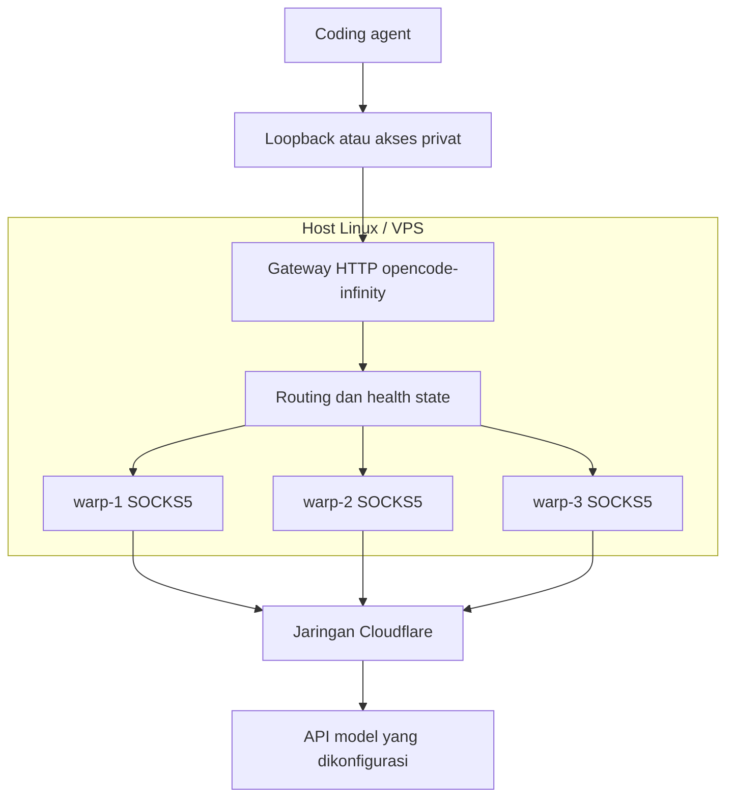
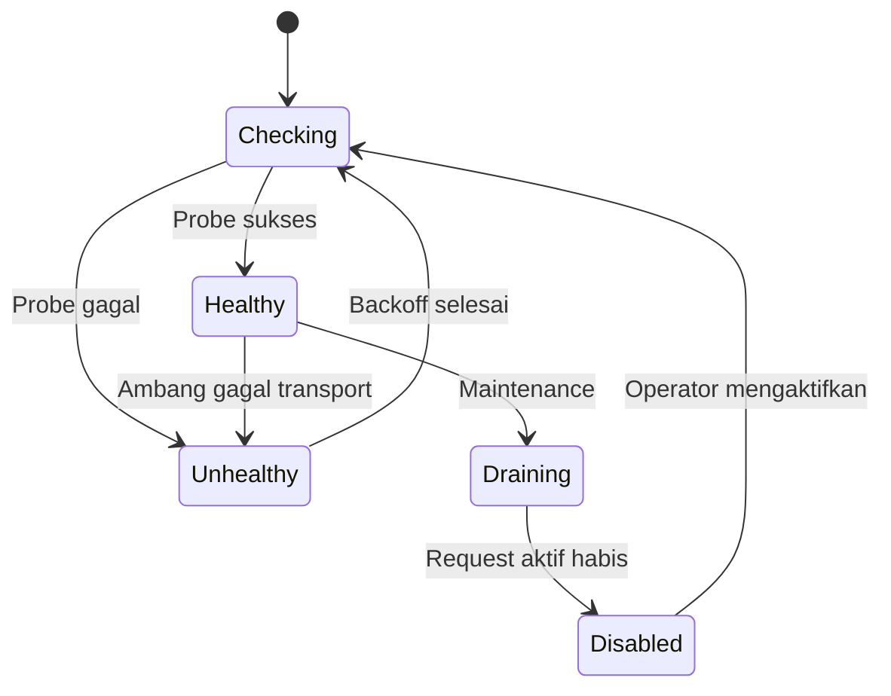

# Catatan teknis — opencode-infinity

Versi pendamping: 0.1.2  
Tanggal revisi: 22 November 2026  
Status: Draft; belum disetujui  
Dokumen utama: [PRD](PRD.md)  
Acuan arsitektur terkini: [ARCHITECTURE](ARCHITECTURE.md)

## Kedudukan dokumen

Dokumen ini mempertahankan user stories serta rincian teknis dari PRD 0.1.0: arsitektur, alur request, endpoint, konfigurasi, routing, keamanan, error contract, AC-01–AC-19, deployment, dan milestone. Isinya dipindahkan tanpa perubahan agar ide dan catatan awal tetap dapat ditelusuri. Nomor bagian asli dipertahankan, sehingga urutannya tidak dimulai dari satu.

PRD terkini dan [keputusan pengguna](DECISIONS.md) menjadi acuan tujuan, cakupan, prioritas, dan kriteria keberhasilan produk. Catatan ini menjadi masukan desain implementasi; pemindahan isi tidak berarti pilihan teknisnya telah disetujui atau diuji. Seluruh default, angka target, dan pilihan implementasi yang masih berupa usulan dalam naskah asal berstatus **(agent's call)**, bukan keputusan pengguna.

### Tambahan kebutuhan versi 0.1.2

Pengguna menetapkan [warp-relay-pool](https://github.com/trefeon/warp-relay-pool) sebagai sumber referensi utama dan meminta web UI dashboard untuk memantau relay pool. C-14 kini masuk MVP **(agent's call: prioritas/fase)**. Naskah historis di bawah tetap utuh; milestone M2/M3 dan paket rilis terkini mengikuti PRD 0.1.2, termasuk dashboard. Referensi bukan bukti bahwa dashboard opencode-infinity telah tersedia.

Dashboard memakai sumber status dan metrik gateway yang sudah direncanakan, dengan batas akses admin privat. Pemilihan framework UI, mekanisme pengiriman pembaruan, dan kontrak autentikasi browser ditetapkan saat desain; tidak ada pilihan library baru yang dikunci lewat PRD.

Tambahan skenario penerimaan berikut merupakan penjabaran kebutuhan **(agent's call)** dan melengkapi AC-01–AC-19, tanpa mengubah nomor atau isi skenario lama:

| ID | Skenario | Bukti lulus |
|---|---|---|
| AC-20 | Pemantauan pool melalui browser | Seluruh relay terkonfigurasi muncul; ringkasan pool dan detail state, request aktif/kapasitas, IP teramati, cooldown, serta alasan gangguan sesuai sumber status gateway pada fixture terkontrol |
| AC-21 | Pembaruan dan kegagalan sumber data | Perubahan relay tercermin otomatis sesuai target pembaruan yang disepakati pada O-10; kegagalan mengambil status ditandai dengan waktu pembaruan terakhir; data lama tidak ditampilkan sebagai kondisi terbaru |
| AC-22 | Otorisasi dan privasi dashboard | Pengguna tanpa otorisasi admin tidak dapat membaca data operasional melalui UI maupun sumber datanya; credential upstream, token admin, prompt/response, dan raw session ID tidak muncul dalam payload pemantauan atau tampilan dashboard |

Uji browser mencakup relay sehat, relay gagal, drain, cooldown, IP tidak tersedia/duplikat, serta sumber status tidak dapat dihubungi. Data fixture dibandingkan dengan tampilan; keberhasilan render saja tidak cukup untuk menyatakan C-14 lulus. Skenario di atas adalah rencana pengujian, bukan hasil tes yang telah dijalankan.

### Klarifikasi untuk pembacaan

- Listener `0.0.0.0` dalam contoh adalah binding di dalam container; akses host secara default tetap loopback sebagaimana dijelaskan pada bagian 11. Admin tetap privat.
- Contoh dua relay dengan masing-masing kapasitas empat hanya menyediakan delapan slot. Benchmark 20 stream memerlukan konfigurasi fixture dan total kapasitas relay yang memadai; contoh YAML tersebut bukan konfigurasi benchmark.
- Jaminan strict affinity setelah restart bergantung pada sinyal sesi eksplisit dan integrasi client. Detail masa berlaku sesi, pembedaan sesi baru/lanjutan, dan penolakan sesi lama perlu divalidasi sebelum klaim kompatibilitas; lihat O-4 di PRD.
- Deadline drain memberi operator status request yang belum selesai; deadline bukan izin menghentikan paksa stream. Kebijakan shutdown proses harus diselaraskan dengan prinsip tersebut sebelum rilis; lihat O-5 di PRD.
- Referensi eksternal menjelaskan proyek lain atau dokumentasi integrasi. Klaimnya tidak otomatis menjadi jaminan perilaku opencode-infinity.

## Naskah teknis yang dipertahankan dari PRD 0.1.0

## 4. Pengguna dan user stories

Pengguna utama adalah developer yang memakai OpenCode dan mengoperasikan gateway sendiri. Pengguna sekunder adalah operator tim kecil yang mengelola satu deployment untuk beberapa client terpercaya.

| ID | User story | Hasil yang diharapkan |
|---|---|---|
| US-01 | Sebagai developer, saya ingin menambahkan satu custom provider | Agent dapat melakukan percakapan dan tool calling melalui gateway |
| US-02 | Sebagai operator, saya ingin memakai beberapa container WARP di satu host | Gateway mengenali tiap relay sebagai jalur transport terpisah |
| US-03 | Sebagai developer, saya ingin token tampil segera saat upstream streaming | Gateway meneruskan SSE tanpa menunggu respons lengkap |
| US-04 | Sebagai operator, saya ingin mengetahui penyebab request gagal | Status membedakan auth, quota, transport, timeout, dan upstream error |
| US-05 | Sebagai developer, saya ingin percakapan yang sensitif terhadap jalur tetap konsisten | Routing mengikuti kebijakan affinity yang dikonfigurasi |
| US-06 | Sebagai operator, saya ingin melakukan maintenance satu relay | Relay dapat di-drain tanpa menghentikan stream pada relay lain |
| US-07 | Sebagai operator, saya ingin memindahkan kredensial upstream tanpa mengubah agent | Agent tetap memakai token gateway; upstream secret diperbarui di server |

## 6. Arsitektur produk

Arsitektur berikut merupakan rancangan opencode-infinity, bukan salinan persis stack referensi.



| Komponen | Tanggung jawab |
|---|---|
| Client | Mengirim request API dan menjalankan tool di lingkungan agent |
| Gateway | Auth, validasi, pemetaan model/path, streaming, dan error envelope |
| Router | Memilih relay yang eligible dan menjaga aturan affinity |
| Relay WARP | Menyediakan SOCKS5 serta tunnel keluar yang terisolasi per container |
| Upstream | Menjalankan inferensi, menentukan akses model, kuota, dan biaya |
| Operator | Menyediakan WARP, konfigurasi, credential, dan akses jaringan |

Gateway MVP mengakses SOCKS5 langsung. Proses relay HTTP dari warp-relay-pool tidak menjadi dependensi wajib. Jika image atau source MicroWARP dari proyek referensi digunakan, versi, lisensi, dan perilakunya harus diverifikasi pada spike deployment dan dicatat di dokumentasi rilis.

## 7. Alur request

1. Agent mengirim POST ke endpoint Chat Completions dengan token gateway.
2. Gateway membuat request ID, memvalidasi token, ukuran body, JSON, dan model alias.
3. Alias menentukan satu upstream, model ID sebenarnya, credential server, dan daftar relay yang diizinkan.
4. Router memilih relay sesuai health, kapasitas, dan kebijakan affinity.
5. Gateway membentuk URL upstream dari konfigurasi server; client tidak dapat mengganti origin atau prefix upstream.
6. Request dikirim melalui SOCKS5 relay terpilih. Resolusi hostname tujuan harus menggunakan jalur proxy, dengan verifikasi TLS terhadap hostname upstream asli.
7. Gateway meneruskan status, body, serta header upstream yang diizinkan. SSE dialirkan bertahap dengan backpressure.
8. Ketika client memutus koneksi, gateway membatalkan request upstream dan melepaskan slot konkurensi.
9. Gateway mencatat metadata hasil, durasi, dan relay, kemudian memperbarui status kesehatan yang relevan.

Tidak ada fallback diam-diam ke koneksi internet langsung ketika SOCKS5 gagal.

## 8. Kontrak API dan integrasi client

### 8.1 Endpoint

| Method | Path | Perilaku |
|---|---|---|
| GET | `/v1/models` | Katalog model alias yang tersedia pada default upstream |
| POST | `/v1/chat/completions` | Generasi pada default upstream; mendukung stream true/false |
| GET | `/providers/{id}/v1/models` | Katalog untuk upstream tertentu |
| POST | `/providers/{id}/v1/chat/completions` | Generasi pada upstream tertentu |
| GET | `/health/live` | Liveness proses, tanpa request berbayar ke upstream |
| GET | `/health/ready` | Kesiapan konfigurasi default dan sedikitnya satu relay eligible |

Default upstream harus ditentukan eksplisit ketika ada lebih dari satu upstream. Endpoint default dan endpoint provider spesifik menggunakan handler yang sama agar tidak terjadi perbedaan perilaku.

Endpoint admin berada pada listener loopback terpisah, default port 8788. `/admin/status`, `/metrics`, dan perubahan state relay memerlukan token admin tersendiri. Endpoint generasi tidak memberikan akses admin.

### 8.2 Konfigurasi agent

Nilai integrasi standar:

| Pengaturan | Contoh |
|---|---|
| Provider ID | `infinity` |
| Base URL lokal | `http://127.0.0.1:8787/v1` |
| Base URL upstream tertentu | `http://127.0.0.1:8787/providers/primary/v1` |
| API key pada agent | Token gateway yang diterbitkan operator |
| Model ID | Alias dari katalog gateway, misalnya `coding-default` |

Agent tidak mengisi alamat `socks5://...`, credential upstream, `x-relay-target`, atau `x-relay-path`. Deployment remote mengganti host pada baseURL dengan alamat privat yang dapat diakses client.

Dokumentasi OpenCode yang diperiksa saat penyusunan mendukung custom provider, endpoint override, dan header tambahan [S3]. Panduan implementasi wajib memverifikasi schema terhadap versi OpenCode yang diuji. Rilis mencatat versi CLI, Desktop, dan runtime provider; tidak mengklaim semua versi kompatibel.

Contoh JSONC client harus disertakan saat implementasi setelah pengujian versi selesai. Untuk Pi atau agent lain, dokumentasi menyebutkan versi yang benar-benar diuji; kompatibilitas protokol tidak otomatis dianggap bukti integrasi.

### 8.3 Transparansi protokol

- Gateway hanya mengubah `model` sesuai mapping dan header autentikasi/transport yang diperlukan.
- Field request yang belum dikenal diteruskan selama tidak melanggar batas ukuran dan aturan routing.
- Content, tools, tool_choice, tool_call_id, reasoning extensions, usage, dan finish_reason tidak diubah semantiknya.
- Tidak mengiklankan capabilities yang belum didukung upstream dan lulus uji.
- Respons model ID tetap mengikuti upstream; dokumentasi menjelaskan mapping alias, tanpa memodifikasi setiap SSE delta.
- Endpoint Responses API mengembalikan error unsupported sampai fitur tersebut diimplementasikan; tidak dialihkan diam-diam ke Chat Completions.
- Redirect upstream tidak diikuti; gateway mengembalikan error terstruktur tanpa meneruskan credential ke origin lain.

## 9. Routing, affinity, dan kegagalan

### 9.1 Pemilihan relay

Default adalah `fixed`: satu relay utama per mapping model/upstream dan daftar fallback yang berurutan. Ini memudahkan diagnosis dan menjaga kestabilan jalur tanpa memerlukan dukungan session ID dari agent.

Opsi `least_inflight` hanya dapat diaktifkan pada model yang dinyatakan stateless oleh operator dan diuji kompatibilitasnya. Relay dengan request aktif paling sedikit dipilih; tie-break menggunakan urutan stabil. Tidak ada pergantian model, upstream, atau credential secara otomatis.

Eligibility dihitung dari kombinasi status transport global, drain state, kapasitas, dan cooldown pada scope upstream/model. Satu upstream yang gagal tidak otomatis membuat relay gagal untuk semua upstream.

### 9.2 Affinity

Model yang memerlukan jalur konsisten memakai `affinity: strict`. Selama percakapan atau binding masih aktif, gateway tidak memindahkannya ke relay atau generasi identitas WARP yang lain.

Jika client mampu mengirim `X-Infinity-Session`, binding dikunci berdasarkan identitas token, upstream, model, dan session ID. TTL default adalah 60 menit sejak request terakhir, dapat dikonfigurasi. Jumlah binding dibatasi; binding aktif tidak dihapus untuk memberi ruang request baru. Binding baru ditolak dengan error kapasitas jika batas tercapai.

Tanpa session ID, `strict` memakai fixed relay bersama pada scope upstream/model. Dokumentasi menyebutkan konsekuensinya: tidak ada isolasi percakapan per agent. Gateway tidak menebak session dari isi prompt atau hash pesan. Plugin pemasang session ID dinamis termasuk P1.

Jaminan binding lintas-request dengan deteksi sesi lama setelah restart memerlukan session ID eksplisit. Tanpa sinyal itu, fixed routing hanya menjamin pemilihan relay dalam lifetime proses; gateway tidak dapat mengenali percakapan lama setelah restart. Model yang mensyaratkan jaminan lebih kuat tidak boleh diaktifkan tanpa integrasi sesi yang memadai. Kombinasi `strict` dan `least_inflight` ditolak saat validasi konfigurasi.

Identitas relay mencakup ID container logis dan nomor generasi. Restart/rekey yang dikendalikan operator menaikkan generasi dan membatalkan binding lama secara eksplisit. Perubahan IP teramati yang relevan menandai binding sebagai tidak valid. Probe tidak dapat menjamin alamat keluar identik untuk setiap tujuan; model yang memerlukan identitas jaringan absolut harus dinyatakan tidak kompatibel jika syarat itu tidak dapat dibuktikan.

### 9.3 Retry dan failover

| Kondisi | Perilaku default |
|---|---|
| Relay gagal sebelum request aplikasi dapat terkirim | Untuk mapping non-strict, boleh satu percobaan pada relay fallback; total maksimal dua attempt |
| POST mungkin sudah terkirim, termasuk timeout menunggu header | Jangan ulang otomatis; upstream mungkin sudah memproses atau menagih request |
| Body JSON atau event SSE sudah mulai dikirim ke client | Jangan failover atau menambahkan respons generasi lain |
| Strict binding kehilangan relay/identitas | Kembalikan error affinity; jangan pindah otomatis |
| Upstream 400/404/422 | Teruskan error; jangan rotasi relay |
| Upstream 401/403 | Teruskan error; tampilkan masalah credential/akses, tanpa rotasi |
| Upstream 429 | Hormati Retry-After; klasifikasikan scope bila ada bukti; jangan restart WARP atau ulang otomatis |
| Upstream 5xx | Teruskan error; tidak mengulang generasi secara default |
| Semua relay tidak eligible | Kembalikan 503 dengan retry hint bila waktu ketersediaan diketahui |

Kegagalan sebelum pengiriman harus dapat dibuktikan oleh lapisan transport. Kegagalan yang ambigu diperlakukan sebagai request yang mungkin sudah terkirim. Mode kompatibilitas MVP hanya melakukan satu attempt jika bukti tersebut tidak tersedia.

Rate limit account/key/project tidak diselesaikan dengan mengganti IP. Scope 429 yang tidak diketahui dianggap upstream/credential-wide secara konservatif. Cooldown model/credential tidak membuat liveness proses gagal. Gateway tidak mengklaim prefix IPv6 tertentu pasti menjadi satuan rate limit semua provider.

Client mungkin mempunyai retry sendiri. Panduan integrasi harus menjelaskan bagaimana menghitung total attempt client dan gateway, serta keterbatasan pencegahan duplikasi tanpa idempotency yang didukung upstream.

### 9.4 State relay



Draining menolak assignment baru. Request aktif diselesaikan sampai batas drain 60 detik, dapat dikonfigurasi. Setelah deadline, operator melihat status belum selesai; penghentian paksa hanya melalui tindakan eksplisit. Binding strict yang masih aktif memblokir maintenance identitas sampai operator memutuskan untuk membatalkannya.

Rotasi/rekey otomatis akibat 429 bukan perilaku MVP. Restart container dilakukan operator melalui Compose setelah drain dan pemeriksaan binding. Gateway tidak dipasangi Docker socket atau privilege NET_ADMIN; privilege jaringan hanya diberikan pada container WARP sesuai kebutuhan image yang diverifikasi.

## 10. Health check dan observabilitas

Health check membedakan empat hal: proses hidup, SOCKS5 dapat dihubungi, jalur HTTPS keluar berfungsi, dan upstream/model dapat digunakan. Sukses pada satu lapisan tidak membuktikan seluruh lapisan sehat.

Default usulan: probe ringan setiap 30 detik dengan jitter, timeout 5 detik, tiga kegagalan berturut-turut sebelum unhealthy, dan dua keberhasilan untuk pulih. Probe generasi model yang memakai kuota tidak berjalan otomatis.

### 10.1 Status operasional

`/admin/status` menyediakan:

- Relay ID, generasi, state, request aktif, kapasitas, serta waktu probe terakhir.
- IPv4 dan IPv6 keluar yang teramati jika tersedia, tujuan probe, dan waktu observasinya.
- Duplikasi alamat yang teramati antar-relay, tanpa menyimpulkan prefix atau akun terisolasi.
- Kesehatan/cooldown upstream, alasan ringkas, dan waktu boleh mencoba lagi.
- Binding aktif dalam bentuk hitungan; session ID mentah tidak ditampilkan.
- Versi gateway dan fingerprint konfigurasi tanpa secret.

Probe IPv4 dan IPv6 terpisah. IP yang terlihat di endpoint probe bukan bukti bahwa API tujuan selalu melihat IP yang sama. Ketiadaan IPv6 atau kesamaan IPv4 ditampilkan sebagai kondisi jaringan, bukan otomatis dianggap kerusakan container.

### 10.2 Log dan metrik

Log JSON memuat request ID, model alias, upstream ID, relay ID, status, attempt count, durasi, dan kategori error. Prompt, output, body tool, authorization, secret, serta raw session ID tidak dicatat secara default.

Metrik minimum: request total, error per kategori, active requests, relay availability, cooldown, latency, waktu ke byte pertama, dan attempt count. Label dibatasi pada identifier konfigurasi; tidak menggunakan request/session ID sebagai label metrik.

Penggunaan token diteruskan dari upstream jika tersedia. Gateway tidak menebak billing atau mengubah ketiadaan usage menjadi angka nol.

## 11. Konfigurasi dan credential

Konfigurasi YAML berikut adalah kontrak produk yang diusulkan, bukan konfigurasi warp-relay-pool atau library pihak ketiga. Seluruh nilai default harus terdokumentasi dan tervalidasi.

```yaml
version: 1
server:
  listen: 0.0.0.0:8787
  admin_listen: 0.0.0.0:8788
  gateway_token_env: INFINITY_GATEWAY_TOKEN
  admin_token_env: INFINITY_ADMIN_TOKEN
  default_upstream: primary
  max_body_bytes: 10485760
  max_active_requests: 20

timeouts:
  connect_seconds: 10
  response_headers_seconds: 120
  stream_idle_seconds: 120
  total_request_seconds: 1800

relays:
  - id: warp-1
    proxy_url: socks5h://warp-1:1080
    max_inflight: 4
  - id: warp-2
    proxy_url: socks5h://warp-2:1080
    max_inflight: 4

upstreams:
  - id: primary
    base_url: https://api.provider.example/v1
    api_key_env: INFINITY_UPSTREAM_KEY
    relays: [warp-1, warp-2]
    models:
      - alias: coding-default
        upstream_model: provider-model-id
        routing: fixed
        primary_relay: warp-1
        fallback_relays: [warp-2]
        affinity: none
```

Pada contoh, listener bind ke semua interface di dalam container. Compose wajib mempublikasikan port API dan admin ke loopback host secara default, misalnya host `127.0.0.1` pada port 8787 dan 8788. Mengubah host binding untuk akses remote memerlukan konfigurasi eksplisit; admin tetap privat.

Aturan konfigurasi:

- Token gateway, admin, dan upstream harus terpisah; startup menolak placeholder atau secret kosong.
- Secret berasal dari environment proses/container atau file secret yang di-mount read-only; file secret bukan bagian source control.
- `socks5h` menyatakan kebutuhan resolusi tujuan melalui proxy; implementasi wajib membuktikan perilakunya melalui tes, bukan hanya menerima string URL.
- Registry model dan routing divalidasi sebelum melayani trafik. Alias ganda, relay hilang, dan URL upstream tidak valid menggagalkan startup.
- Perubahan konfigurasi membutuhkan restart gateway pada MVP; hot reload termasuk pengembangan berikutnya.
- State health dan binding berada di memory. Restart gateway menghapus binding; client strict menerima error binding setelah restart dan perlu memulai sesi baru.
- Untuk binding strict, sesi yang tidak dikenal tidak dibuat ulang diam-diam jika client sedang melanjutkan percakapan. Kontrak pembentukan sesi menggunakan header `X-Infinity-Session-Start: true` pada request pertama; client tanpa kemampuan itu memakai fixed scope yang dijelaskan sebelumnya.

## 12. Keamanan dan privasi

Semua endpoint model memerlukan bearer token gateway, termasuk `/v1/models`. Token client tidak diteruskan ke upstream; gateway menggantinya dengan credential upstream dari server.

Hanya origin/path prefix dari konfigurasi server yang boleh menjadi target. Header client seperti `x-relay-target` ditolak. Endpoint tidak dapat digunakan sebagai arbitrary URL fetcher. Redirect tidak diikuti. URL dengan userinfo, fragment, atau scheme selain HTTPS ditolak untuk upstream internet.

Koneksi upstream memverifikasi sertifikat TLS dan hostname. Header hop-by-hop dan header internal gateway dihapus. Log/error tidak memuat secret atau URL bertoken. Body request dibatasi 10 MiB secara default, termasuk body setelah decoding; encoding yang tidak didukung ditolak secara eksplisit.

Sesi dipisahkan berdasarkan identitas token agar client berbeda tidak berbagi binding secara tidak sengaja. MVP bukan isolasi tenant penuh: operator gateway tetap berada pada trust boundary yang dapat membaca konten request selama pemrosesan.

Tidak ada penyimpanan prompt/response atau riwayat percakapan secara default. Request yang melewati upstream tetap mengikuti kebijakan data upstream dan jaringan transport yang digunakan.

## 13. Target nonfungsional

Angka berikut adalah target penerimaan rancangan, bukan hasil benchmark.

| Aspek | Target MVP dan metode ukur |
|---|---|
| Streaming | SSE pertama diteruskan tanpa menunggu event berikutnya; urutan byte/delta tetap |
| Overhead gateway | p95 tambahan <=50 ms pada fixture upstream lokal dan SOCKS5 uji, dibanding jalur SOCKS5 yang sama tanpa gateway |
| Konkurensi | 20 request streaming bersamaan selama 30 menit pada host 2 vCPU/2 GiB dengan upstream fixture terkontrol |
| Memori gateway | <=256 MiB RSS pada skenario tersebut, di luar container WARP dan agent |
| Pembatalan | Request upstream dibatalkan <=2 detik setelah disconnect terdeteksi |
| Shutdown | Berhenti menerima request baru, drain sampai 60 detik, kemudian exit sesuai kebijakan terdokumentasi |
| Timeout | Header, idle stream, dan total timeout terpisah; client disconnect tidak menunggu total timeout |
| Kejelasan error | Semua error gateway sebelum stream memakai envelope seragam dan request ID |

Jika upstream putus setelah streaming dimulai, gateway tidak dapat mengubah status HTTP yang sudah dikirim. Koneksi ditutup, event error hanya dikirim jika kontrak stream mengizinkannya, dan penyebab dicatat dengan request ID. Tidak ada event selesai sukses palsu.

## 14. Error contract

Contoh error yang dibuat gateway sebelum response streaming dimulai:

```json
{
  "error": {
    "message": "No eligible relay is available for this model.",
    "type": "gateway_unavailable",
    "code": "no_eligible_relay"
  },
  "request_id": "req_example"
}
```

| Kondisi | Status | Code |
|---|---|---|
| Token tidak valid | 401 | `invalid_gateway_token` |
| Model alias tidak ditemukan | 404 | `model_not_found` |
| Body melampaui batas | 413 | `request_too_large` |
| Kapasitas gateway habis | 429 | `gateway_capacity_exceeded` |
| Binding strict tidak valid | 409 | `affinity_lost` |
| Tidak ada relay eligible | 503 | `no_eligible_relay` |
| Koneksi proxy/upstream gagal | 502 | `upstream_transport_error` |
| Timeout sebelum respons dimulai | 504 | `upstream_timeout` |
| Endpoint/protokol tidak didukung | 501 | `unsupported_api` |

Error dari upstream mempertahankan status dan body aslinya dengan header request ID gateway. `Retry-After` upstream diteruskan bila tersedia dan valid. Error gateway dibedakan dari error upstream melalui header `X-Infinity-Error-Source`.

## 15. Acceptance criteria dan pengujian

| ID | Skenario | Bukti lulus |
|---|---|---|
| AC-01 | Integrasi OpenCode CLI | Model alias dapat dipilih; percakapan biasa dan satu siklus tool call selesai |
| AC-02 | Integrasi OpenCode Desktop | Alur AC-01 berhasil dari Desktop dengan versi dicatat |
| AC-03 | SSE terfragmentasi | Parser client menerima content dan tool-call deltas pada fragmentasi byte acak |
| AC-04 | Upstream JSON/non-stream | Status, content type, payload, dan usage diteruskan |
| AC-05 | Proxy terpilih | SOCKS5 fixture mencatat relay yang dipilih; tidak ada koneksi langsung ke upstream |
| AC-06 | DNS melalui proxy | Fixture membuktikan hostname tujuan diteruskan ke SOCKS5, bukan diselesaikan lokal |
| AC-07 | Gangguan relay sebelum dispatch | Fallback non-strict sesuai batas attempt dan hanya saat belum terkirim terbukti |
| AC-08 | POST ambigu atau SSE terputus | Tidak terjadi request generasi kedua secara otomatis |
| AC-09 | 429 upstream | Retry-After dan cooldown diterapkan tanpa restart WARP atau penggantian key |
| AC-10 | Auth invalid | Token gateway ditolak; credential upstream tidak bocor ke client/log |
| AC-11 | Target bebas/redirect | Request tidak dapat mengubah tujuan atau mengirim credential ke origin lain |
| AC-12 | Client disconnect | Upstream dibatalkan dan slot konkurensi dilepas |
| AC-13 | Strict affinity | Sesi memakai relay/generasi sama; kehilangan binding menghasilkan 409 |
| AC-14 | Restart gateway | Binding strict lama tidak dibuat ulang sebagai sesi lanjutan secara diam-diam |
| AC-15 | Drain | Relay tidak mendapat assignment baru; stream relay lain tetap berjalan |
| AC-16 | Semua relay down | 503 terstruktur; tidak ada fallback ke internet langsung |
| AC-17 | IPv4 duplicate / IPv6 absent | Status menampilkan hasil observasi tanpa menjanjikan IP unik |
| AC-18 | Batas ukuran dan kapasitas | Body oversized dan overload ditolak tanpa memory growth tak terbatas |
| AC-19 | Benchmark | Target pada bagian 13 diuji dengan fixture, command, dan konfigurasi yang dapat direproduksi |

Tes integrasi menggunakan upstream/SOCKS5 fixture agar deterministik dan tidak menghabiskan kuota. Smoke test upstream nyata bersifat eksplisit, memakai credential operator dan model yang tersedia. Lulus fixture tidak menggantikan bukti integrasi OpenCode CLI/Desktop.

## 16. Implementasi dan deployment yang diusulkan

Stack awal yang disarankan adalah Go untuk gateway, YAML untuk konfigurasi, dan Docker Compose pada Linux untuk gateway plus WARP. Pilihan Go merupakan usulan teknis awal; kontrak produk tidak bergantung pada framework web tertentu. Library transport harus dipilih lewat spike dukungan SOCKS5, DNS proxy, TLS, streaming, cancellation, dan kontrol retry.

Client dapat berjalan di Linux, macOS, atau Windows selama versi agent yang digunakan mendukung custom endpoint. Ini tidak berarti host WARP native di semua OS masuk scope MVP. Untuk deployment lokal macOS/Windows melalui VM Docker, dukungan kernel/network dan performanya perlu divalidasi terpisah.

Deliverable implementasi:

1. Binary gateway, image container yang versinya dipin, dan Compose contoh dengan minimal dua relay.
2. Config example dan secret example berisi placeholder tanpa credential nyata.
3. Perintah/prosedur validate config, startup, status, drain, maintenance, dan shutdown.
4. Panduan integrasi OpenCode CLI/Desktop serta daftar versi yang diuji.
5. Panduan troubleshooting IPv4/IPv6, WARP unreachable, quota, dan stream terputus.
6. Suite pengujian acceptance dan laporan benchmark yang dapat direproduksi.

## 17. Tahapan pengerjaan

| Tahap | Fokus | Exit criteria |
|---|---|---|
| M0 — Spike | Transport SOCKS5, DNS, SSE, WARP pada host Linux, dan versi OpenCode | Satu request nyata melewati satu WARP; fixture membuktikan tidak ada direct fallback |
| M1 — Gateway dasar | Auth, model registry, mapping path, JSON/SSE | AC-03–06, AC-10–11 dan endpoint dasar lulus |
| M2 — Pool | Routing, capacity, health, cooldown, affinity, cancellation | AC-07–09 dan AC-12–18 lulus |
| M3 — Integrasi rilis | CLI/Desktop, deployment, benchmark, dokumentasi | AC-01–02 dan AC-19 lulus; versi/limit terdokumentasi |

Tidak ada estimasi kalender sampai spike M0 selesai dan constraint host/upstream sudah diketahui.

## 19. Referensi

Diakses 22 November 2026. Referensi menjelaskan integrasi dan inspirasi awal; aturan MVP dalam dokumen ini adalah keputusan desain yang diusulkan.

- [S1 — warp-relay-pool](https://github.com/trefeon/warp-relay-pool): konteks pool WARP dan batasan alamat keluar.
- [S2 — Overview: how it works](https://github.com/trefeon/warp-relay-pool/blob/main/docs/01-overview-how-it-works.md): kontrak relay HTTP, SOCKS5, dan opsi ingress proyek referensi.
- [S3 — OpenCode Providers](https://opencode.ai/docs/providers/): konfigurasi custom provider dan endpoint pada dokumentasi yang diperiksa.

