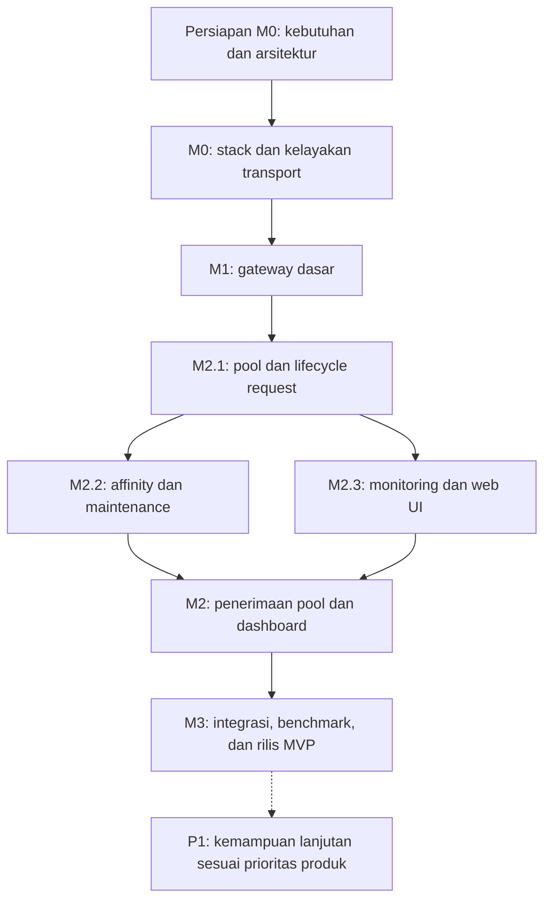

# ROADMAP opencode-infinity

Versi: 0.1.0  
Tanggal: 22 November 2026  
Status: Draft rencana pengerjaan  
Target rilis dan penanggung jawab: TBD, mengikuti O-8 pada PRD

Target pertama adalah MVP gateway satu host yang menghubungkan coding agent ke upstream melalui pool WARP, dengan **web UI dashboard sebagai bagian dari penerimaan MVP**. Pengerjaan mengikuti urutan **validasi kebutuhan dan arsitektur → pemilihan stack → pembuktian transport → gateway → pool dan dashboard → integrasi serta rilis**.

## 1. Dasar dan batas roadmap

| Dokumen | Versi acuan | Peran |
|---|---|---|
| [PRD](PRD.md) | 0.1.3 | Cakupan, C-1–C-16, tujuan G-1–G-7, kualitas Q-1–Q-11, dan pertanyaan O-1–O-10 |
| [ARCHITECTURE](ARCHITECTURE.md) | 0.1.3 | Keputusan A-1–A-8, pembagian modul, struktur project, sumber state, alur, serta batas kegagalan |
| [TECHSTACK](TECHSTACK.md) | 0.1.1 | Kandidat teknologi; versi, kompatibilitas, dan digest harus divalidasi pada M0 |
| [Catatan teknis](PRD-technical-notes.md) | 0.1.2 | Kontrak awal, AC-01–AC-19, dan tambahan dashboard AC-20–AC-22 |

Milestone M0–M3 tetap mengikuti PRD. Pembagian M2 menjadi beberapa bagian, urutan pekerjaan rinci, dan pembagian peran merupakan usulan **(agent's call)**. Seluruh checkbox adalah pekerjaan yang direncanakan; item hanya ditandai selesai setelah buktinya tersedia.

[D-001–D-003](DECISIONS.md) sudah menetapkan penggunaan pribadi dan deployment container lokal/homelab, dengan akses homelab melalui Tailscale yang disiapkan pengguna. Sisa keputusan CPU/host/runtime serta upstream/client tetap ditangani pada M0.

Tanggal dan durasi tiap milestone tetap **TBD**. Estimasi disusun setelah M0 berdasarkan host, upstream, hasil spike, dan kapasitas pelaksana. C-11, C-12, C-13, C-15, dan C-16 tetap P1. Marketplace, multi-host, riwayat percakapan, serta kontrol lifecycle container melalui dashboard tidak ditambahkan ke MVP.

## 2. Urutan milestone dan dependensi

| Milestone | Hasil utama | Bergantung pada | Status |
|---|---|---|---|
| M0 | Keputusan arsitektur tervalidasi, stack dipilih, satu jalur WARP terbukti | Pilihan host, upstream/model, dan versi client | Direncanakan |
| M1 | Gateway satu relay melayani kontrak dasar dengan benar | M0 lulus | Direncanakan |
| M2.1 | Pool, health, kapasitas, cooldown, dan lifecycle request bekerja | M1 lulus | Direncanakan |
| M2.2 | Binding dan maintenance menjaga konsistensi jalur | State/reservasi atomik M2.1; keputusan O-4/O-5 terkait | Direncanakan |
| M2.3 | Operator memantau pool melalui dashboard yang terlindungi | State/snapshot M2.1; kontrak auth dan kesegaran data | Direncanakan |
| M3 | Integrasi client, seluruh acceptance, paket deployment, dan bukti performa lengkap | Seluruh gerbang M2 lulus | Direncanakan |

M2.2 dan M2.3 dapat berjalan bersamaan setelah kontrak state/snapshot stabil. Integrasi akhir dashboard tetap harus mencerminkan kondisi binding dan maintenance yang sudah diuji. Rilis MVP menunggu keduanya.

## 3. M0 Validasi arsitektur dan kelayakan

**Tujuan:** membuktikan rancangan dapat dijalankan pada host dan client target sebelum membangun gateway lengkap. Pemilik usulan: pemilik produk, pelaksana backend, dan operator; nama TBD.

### Persiapan dan keputusan

- [ ] Tinjau cakupan MVP dan A-1–A-8; catat keputusan serta konsekuensi yang perlu diperbarui pada dokumen.
- [ ] Tetapkan host uji, arsitektur CPU, akses jaringan, dan kebutuhan image WARP; tutup O-2.
- [ ] Pilih upstream/model uji serta versi OpenCode CLI, Desktop, dan runtime provider; tutup O-3.
- [ ] Pastikan model awal sesuai Chat Completions MVP. Jika membutuhkan Responses API atau jaminan affinity yang belum dapat dipenuhi, selesaikan keputusan produk sebelum M0 ditutup.
- [ ] Susun rencana pembuktian AC dan quality bars sebelum implementasi tiap area.

### Pemilihan stack dan spike

- [ ] Bandingkan kandidat TECHSTACK dengan kebutuhan modul dan batas resource ARCHITECTURE; catat stack yang dipilih beserta alasannya.
- [ ] Verifikasi versi stabil terbaru yang saling kompatibel, termasuk runtime build UI, compiler/checker TypeScript, framework/plugin, dependensi Go jika dipilih, serta tooling container.
- [ ] Tinjau kandidat YAML v3 dalam TECHSTACK saat menentukan versi yang dipakai; versi dalam draft tidak dianggap otomatis terbaru atau sudah dipilih.
- [ ] Catat exact version, sumber, dan batas dukungan; kunci dependensi/checksum, commit MicroWARP, serta digest image yang dipakai spike. Periksa kembali sebelum rilis.
- [ ] Siapkan fixture upstream dan SOCKS5 untuk mengamati relay, DNS tujuan, fragmentasi SSE, pembatalan, dan jumlah attempt.
- [ ] Jalankan satu request nyata melalui satu relay WARP pada host target dengan credential operator yang disediakan untuk pengujian.
- [ ] Buktikan DNS tujuan melalui proxy, TLS hostname benar, streaming dapat diteruskan, dan relay gagal tidak memicu koneksi langsung.
- [ ] Periksa retry internal transport dan kemampuan membuktikan request belum terkirim. Jika bukti tidak tersedia, tetapkan satu attempt untuk jalur tersebut.
- [ ] Buktikan aset UI dapat disajikan oleh aplikasi gateway pada bentuk packaging yang dipilih.

**Hasil:** catatan keputusan arsitektur/stack, matriks versi dan image, konfigurasi spike tanpa secret, rencana pengujian, serta bukti transport yang dapat direproduksi.

**Gerbang lulus:** satu request nyata melewati WARP; fixture membuktikan jalur proxy dan tidak ada direct fallback; kontrak model/client awal sesuai cakupan; hambatan yang mengubah kelayakan sudah diputuskan. Hasil spike menjadi dasar estimasi M1–M3. O-4/O-5/O-6/O-10 yang belum selesai mempunyai pemilik dan batas keputusan yang jelas.

## 4. M1 Gateway dasar

**Tujuan:** menyediakan jalur request yang benar melalui satu relay sebelum menambahkan dinamika pool. Cakupan: bagian dasar C-1–C-3 dan C-8. Pemilik usulan: backend dan pengujian; nama TBD.

- [ ] Bangun Configuration Registry dengan validasi upstream, alias model, relay, default upstream, dan secret.
- [ ] Pisahkan akses API model dan admin; terapkan token gateway/admin/upstream sesuai perannya.
- [ ] Terapkan request ID, batas ukuran/protokol, error gateway seragam, serta log metadata yang teredaksi.
- [ ] Layani katalog model dan generasi untuk default upstream maupun provider spesifik melalui jalur internal yang sama.
- [ ] Terapkan mapping alias, penggantian credential, pembatasan target, verifikasi TLS, dan penolakan redirect.
- [ ] Teruskan JSON, SSE terfragmentasi, tool-call deltas, usage, dan field tambahan tanpa mengubah semantik.
- [ ] Jalankan pembuktian SOCKS5/DNS pada implementasi gateway, bukan hanya spike.
- [ ] Sediakan liveness/readiness dasar tanpa request generasi berbayar otomatis.

**Hasil:** gateway dasar, contoh konfigurasi/secret placeholder, dan suite integrasi transport/API.

**Gerbang lulus:** AC-03–AC-06, AC-10, dan AC-11 lulus. Endpoint dasar memakai kontrak yang sama; token dan credential tidak bocor; SSE tidak menunggu respons lengkap. Integrasi CLI/Desktop nyata tetap menjadi gerbang M3.

## 5. M2 Pool operasi dan dashboard

M2 melengkapi C-4–C-7, C-9, dan C-14. Pemilik usulan: backend, web UI, operator, dan pengujian; nama TBD. Peran dapat dipegang orang yang sama sesuai kapasitas yang ditetapkan setelah M0.

### M2.1 Pool dan lifecycle request

- [ ] Implementasikan Pool Manager dan Request Coordinator dengan pemilihan relay serta reservasi slot atomik.
- [ ] Terapkan fixed routing, fallback terbatas, dan least-inflight hanya untuk model stateless yang tervalidasi.
- [ ] Pisahkan kesehatan transport, mode operasi, kapasitas, dan cooldown menurut scope yang diketahui.
- [ ] Jalankan probe terbatas dengan timeout/backoff/jitter; tampilkan IPv4/IPv6 teramati beserta waktu dan keterbatasannya.
- [ ] Bedakan auth, quota, transport, timeout, dan upstream error; terapkan Retry-After/cooldown tanpa rotasi WARP otomatis.
- [ ] Terapkan pembatalan upstream dan pelepasan slot tepat sekali pada EOF, disconnect, error, dan timeout.
- [ ] Batasi total buffer, request aktif, koneksi, dan pekerjaan probe; validasi perilaku overload serta client lambat.
- [ ] Buktikan POST ambigu atau stream yang terputus tidak menghasilkan generasi kedua otomatis.
- [ ] Tetapkan kontrak snapshot status yang akan dipakai dashboard, termasuk alasan eligibility dan metadata waktu.

**Hasil:** pool multi-relay, state operasional yang konsisten, lifecycle request, dan kontrak snapshot untuk UI.

**Gerbang lulus:** AC-07–AC-09, AC-12, AC-15–AC-16, dan AC-18 lulus. Dasar drain menolak assignment baru; konsistensi binding selama maintenance diselesaikan pada M2.2.

### M2.2 Affinity dan maintenance

- [ ] Selesaikan lifecycle sesi baru/lanjutan, TTL, expiry, dan restart sesuai kemampuan client; tutup O-4 sebelum klaim strict affinity per percakapan.
- [ ] Implementasikan binding pada scope token/upstream/model/session dengan batas kapasitas dan relay/generasi yang tetap.
- [ ] Tolak binding hilang/tidak valid secara eksplisit; uji bahwa binding aktif tidak digusur dan tidak dipindahkan diam-diam.
- [ ] Uji perubahan identitas yang diketahui serta batas deteksi perubahan eksternal.
- [ ] Lengkapi drain dengan pemeriksaan request aktif dan binding sebelum maintenance identitas.
- [ ] Susun prosedur restart/rekey oleh operator, pembatalan binding eksplisit, pembaruan generasi, dan pemeriksaan health sebelum enable.
- [ ] Selaraskan shutdown, deadline drain, serta grace period container; tutup O-5 sebelum gerbang rilis.
- [ ] Dokumentasikan batas fixed routing untuk client tanpa sinyal sesi eksplisit; plugin session ID dinamis tetap P1.

**Hasil:** binding teruji, prosedur maintenance/shutdown, dan batas kompatibilitas sesi yang jelas.

**Gerbang lulus:** AC-13–AC-14 lulus dan AC-15 diverifikasi bersama binding aktif. Kehilangan affinity tidak berubah menjadi routing baru secara diam-diam; kebijakan deadline tidak mengklaim semua stream pasti selesai.

### M2.3 Monitoring dan web UI dashboard

- [ ] Bangun Snapshot Builder dari state/telemetry yang dipakai gateway; redaksi dilakukan sebelum data dikirim.
- [ ] Tampilkan ringkasan pool dan seluruh relay terkonfigurasi: state, generasi, inflight/kapasitas, observasi IP, cooldown, serta alasan gangguan.
- [ ] Sediakan log metadata dan metrik operasional dengan label yang dibatasi; raw session/request ID tidak menjadi label metrik.
- [ ] Tetapkan kontrak autentikasi browser, lifecycle sesi admin, dan perlindungan endpoint status/metrik.
- [ ] Tentukan target interval pembaruan serta keterlambatan maksimum; tutup O-10. Usulan lima detik pada TECHSTACK tetap kandidat sampai diputuskan.
- [ ] Terapkan pembaruan otomatis, waktu data terakhir, dan penanda gagal/stale; bedakan waktu snapshot dari waktu probe relay.
- [ ] Pastikan refresh UI atau banyak tab tidak memicu probe upstream baru dan tidak menahan dispatch generasi.
- [ ] Integrasikan UI ke artefak aplikasi; uji pemantauan melalui browser terhadap fixture yang berubah.
- [ ] Buktikan token generasi tidak memberi akses admin dan snapshot/tampilan tidak mengungkap secret atau konten percakapan.

**Hasil:** dashboard pemantauan yang berfungsi, status/metrik admin, dan pengujian browser. Kontrol lifecycle container melalui UI tidak termasuk hasil C-14.

**Gerbang lulus:** AC-17 dan AC-20–AC-22 lulus. Nilai UI sesuai sumber status, perubahan dan kegagalan pembaruan dikenali, serta akses tanpa otorisasi ditolak.

**M2 dinyatakan selesai setelah M2.1–M2.3 lulus bersama. Dashboard tidak ditunda ke P1.**

## 6. M3 Integrasi benchmark dan rilis MVP

**Tujuan:** membuktikan C-1–C-10 dan C-14 sebagai satu produk yang dapat dipasang dan dioperasikan. Pemilik usulan: seluruh pelaksana terkait dan penanggung jawab rilis; nama TBD.

- [ ] Jalankan percakapan dan satu siklus tool calling nyata pada OpenCode CLI serta Desktop; catat versi client/runtime provider dan model.
- [ ] Verifikasi seluruh AC-01–AC-22 pada artefak rilis yang sama; hasil fixture tidak menggantikan pengujian client dan WARP nyata.
- [ ] Ukur overhead p95 tambahan ≤50 ms terhadap jalur SOCKS5 pembanding yang sama.
- [ ] Uji 20 stream selama 30 menit pada host 2 vCPU/2 GiB dengan RSS gateway ≤256 MiB, dashboard aktif, dan kapasitas relay mencukupi.
- [ ] Ukur ukuran aset/image dan pemakaian WARP/total deployment secara terpisah; target tambahan yang belum disahkan diselesaikan melalui O-6.
- [ ] Periksa kembali kompatibilitas, dukungan, dan keamanan versi yang dipilih; catat exact version, commit, digest, serta perubahan sejak M0.
- [ ] Siapkan binary/image gateway beserta UI, Compose contoh minimal dua relay, dan konfigurasi/secret placeholder.
- [ ] Uji pemasangan dari konfigurasi bersih, startup, status, akses dashboard, drain, maintenance, restart, serta shutdown sesuai prosedur.
- [ ] Lengkapi panduan integrasi CLI/Desktop dan troubleshooting IPv4/IPv6, quota, WARP unreachable, serta stream terputus.
- [ ] Tetapkan penanggung jawab, pengguna awal, tanggal, dan anggaran rilis melalui O-8; dokumentasikan hasil G-1–G-7 dan Q-1–Q-11.

**Hasil:** paket MVP yang versinya terkunci, suite dan laporan penerimaan, benchmark yang dapat direproduksi, serta panduan operasional/integrasi.

**Gerbang lulus:** seluruh AC-01–AC-22, G-1–G-7, dan Q-1–Q-11 terpenuhi; batas kompatibilitas dan hasil pengukuran tercatat; keputusan yang memblokir rilis telah selesai. Semua angka performa tetap target rancangan sampai dibuktikan pengujian.

## 7. Matriks penerimaan

Milestone berikut adalah tempat bukti pertama diwajibkan. M3 memverifikasi keseluruhan kontrak pada artefak rilis.

| Acceptance | Area | Milestone utama |
|---|---|---|
| AC-01–AC-02 | Integrasi OpenCode CLI/Desktop | M3 |
| AC-03–AC-04 | JSON/SSE, fragmentasi, tool-call deltas | M1 |
| AC-05–AC-06 | Pemilihan proxy dan DNS melalui proxy | M1, dengan pembuktian awal M0 |
| AC-07–AC-09 | Fallback, dispatch ambigu, 429/cooldown | M2.1 |
| AC-10–AC-11 | Auth/secret dan pembatasan target/redirect | M1 |
| AC-12 | Pembatalan upstream dan pelepasan slot | M2.1 |
| AC-13–AC-14 | Strict affinity dan restart | M2.2 |
| AC-15 | Drain tanpa mengganggu relay lain | M2.1, dilengkapi binding pada M2.2 |
| AC-16 | Semua relay down tanpa direct fallback | M2.1 |
| AC-17 | IPv4 duplikat/IPv6 tidak tersedia | M2.3 |
| AC-18 | Ukuran body, overload, dan batas memori | M2.1 |
| AC-19 | Benchmark yang dapat direproduksi | M3 |
| AC-20–AC-22 | Dashboard, kesegaran data, dan otorisasi | M2.3 |

## 8. Keputusan yang menentukan urutan pekerjaan

| Acuan | Keputusan | Pemilik usulan | Dibutuhkan sebelum |
|---|---|---|---|
| O-1 | Pemilik produk/pengukuran, bukti masalah, dan baseline | Pemilik produk, TBD | Evaluasi dampak terhadap baseline; tidak menahan fixture |
| O-2 | Host, arsitektur CPU, dan asumsi deployment | Operator, TBD | M0 selesai |
| O-3 | Upstream/model dan versi/protokol client | Pemilik produk + backend, TBD | M0 selesai |
| O-4 | Lifecycle sesi strict serta perilaku restart | Backend, TBD | M2.2 dinyatakan mendukung strict per percakapan |
| O-5 | Shutdown setelah deadline dan termination container | Backend + operator, TBD | Prosedur shutdown dibakukan dan M3 selesai |
| O-6 | Target performa/default, anggaran resource, dan konfigurasi benchmark | Pemilik produk + pelaksana teknis, TBD | Target penerimaan resource disahkan dan benchmark dinilai |
| O-7 | Kebutuhan dan nilai SLA produksi | Pemilik produk + operator, TBD | Klaim SLA produksi |
| O-8 | Pemilik rilis, pengguna awal, tanggal, dan anggaran | Pemilik produk, TBD | Komitmen jadwal/anggaran dan rilis |
| O-9 | Urutan kemampuan P1 dan prioritas hot reload | Pemilik produk, TBD | Penjadwalan P1 |
| O-10 | Target kesegaran data dashboard | Pemilik produk + backend/UI, TBD | AC-21 dinyatakan lulus |
| A-2/A-5/A-7 | Auth browser, TTL sesi, dan mekanisme pembaruan UI | Backend/UI, TBD | AC-21–AC-22 dinyatakan lulus |

Jika hasil spike bertentangan dengan kebutuhan, catat dampaknya dan perbarui keputusan pada PRD/ARCHITECTURE sebelum mengubah cakupan. Target client, protokol, affinity, dan dashboard tidak boleh dianggap selesai dengan menghilangkan skenario yang belum lulus.

## 9. Pengembangan P1 setelah MVP

Urutan berikut mengikuti ID kapabilitas, bukan komitmen prioritas pengerjaan. Penjadwalannya ditetapkan melalui O-9 setelah penerimaan MVP.

| Kapabilitas | Hasil yang dituju | Dependensi dan gerbang |
|---|---|---|
| C-11 Responses API | Client/model dapat memakai Responses API | Kontrak dan pengujian kompatibilitas terpisah; aturan transport/retry tetap berlaku |
| C-12 Integrasi relay HTTP lama | Operator mempertahankan protokol header warp-relay-pool | Adapter tervalidasi tanpa mengubah kontrak target, auth, dan kegagalan gateway |
| C-13 Controller maintenance | Maintenance WARP dapat diotomasi | Drain, binding, generasi, dan pemeriksaan identitas MVP sudah terbukti |
| C-15 Plugin session ID | Client menyediakan identitas percakapan dinamis | Kontrak sesi gateway stabil dan integrasi plugin diuji pada versi client yang dituju |
| C-16 Export konfigurasi dan secret store | Distribusi konfigurasi client dan pengelolaan secret lebih sederhana | Format client serta integrasi secret store tervalidasi; credential upstream tetap di server |

Hot reload tetap menjadi kemungkinan pengembangan berikutnya dengan prioritas/fase `TBD`. Dashboard pemantauan diselesaikan pada MVP.
