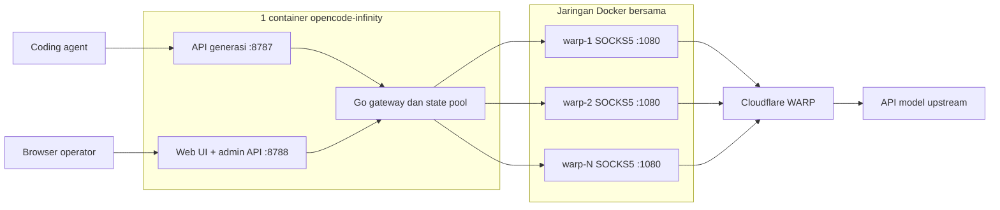

# TECHSTACK opencode-infinity

Versi: 0.1.2  
Tanggal: 22 November 2026  
Status: Kandidat stack MVP; pemilihan mengikuti validasi arsitektur  
Acuan kebutuhan: [PRD terkini](PRD.md) dan [keputusan pengguna](DECISIONS.md)  
Acuan desain: [ARCHITECTURE](ARCHITECTURE.md) dan [catatan teknis](PRD-technical-notes.md)

Urutan perancangan adalah **PRD → ARCHITECTURE → TECHSTACK → implementasi**. Pembagian modul, kepemilikan state, alur request/dashboard, dan batas kegagalan mengikuti ARCHITECTURE. Pilihan di bawah masih kandidat yang dievaluasi sesudah arsitektur divalidasi.

Kandidat awal adalah **Go untuk gateway, Svelte + TypeScript untuk dashboard, MicroWARP untuk relay, dan Docker Compose untuk deployment**. Pada kandidat ini, hasil build dashboard dimasukkan ke binary Go. Satu container gateway/UI dan pool relay menerapkan batas deployment A-1/A-6 pada ARCHITECTURE.

Pilihan ini mengutamakan integrasi melalui SOCKS5 dan jaringan Docker, sedikit proses saat runtime, serta pengujian streaming dan kegagalan sesuai PRD. Seluruh pilihan teknis berikut merupakan usulan **(agent's call)**; kebutuhan dashboard dan referensi warp-relay-pool berasal dari pengguna. Ukuran image dan pemakaian memori aktual perlu dibuktikan melalui M0–M3.

## 1. Stack yang direkomendasikan

| Lapisan | Pilihan | Peran dan alasan |
|---|---|---|
| Backend | Go, standard library | Satu binary untuk routing, health, affinity, admin, dan penyajian UI; dependensi backend dibatasi pada kebutuhan nyata |
| HTTP server | `net/http` dan `http.ServeMux` | Menangani API generasi dan listener admin terpisah |
| Proxy transport | `http.Transport` + `httputil.ReverseProxy` | Transport per relay, koneksi upstream, streaming, dan cancellation |
| Relay WARP | MicroWARP dari `warp-relay-pool`, versi sumber/image dipin | Mempertahankan jalur WireGuard + SOCKS5 proyek referensi |
| Web UI | Svelte + TypeScript | Komponen reaktif untuk ringkasan pool, daftar relay, dan diagnosis |
| Frontend build | Vite + `@sveltejs/vite-plugin-svelte` | Menghasilkan HTML, JS, dan CSS statis untuk disertakan dalam binary |
| Styling | Scoped CSS Svelte + CSS variables | Tampilan konsisten dengan aset lokal dan dependensi UI kecil |
| Penyajian UI | `embed.FS` + HTTP file handler Go | UI dan admin API berasal dari origin yang sama |
| Pembaruan dashboard | JSON snapshot melalui polling browser | Cukup untuk pemantauan pool; sumber data berasal dari state gateway |
| Konfigurasi | YAML + environment/file secret | Mengikuti format rancangan PRD; secret tetap di server |
| State operasional | Memory dengan batas kapasitas | Health, cooldown, inflight, binding, dan sesi dashboard mengikuti lifecycle gateway |
| Logging | `log/slog`, JSON ke stdout | Log metadata terstruktur untuk dibaca operator dan container runtime |
| Metrik | `prometheus/client_golang` | Counter, gauge, histogram, serta endpoint `/metrics` pada listener admin |
| Runtime image gateway | Distroless static nonroot | Menjalankan binary Go dan aset UI yang sudah dibangun |
| Orkestrasi | Docker Compose pada Linux | Satu host dengan service discovery dan volume profil WARP per relay |
| Pengujian | Go `testing`/`httptest`, fixture SOCKS5, Playwright | Bukti transport, perilaku gagal, dan dashboard di browser |

Dasar teknis: Go mendukung proxy SOCKS5 dalam [HTTP transport](https://pkg.go.dev/net/http#Transport), dan [ReverseProxy](https://pkg.go.dev/net/http/httputil#ReverseProxy) mendukung penerusan respons streaming. [Svelte dengan Vite](https://svelte.dev/docs/svelte/getting-started#Alternatives-to-SvelteKit) menghasilkan aset statis; [embed](https://pkg.go.dev/embed) memasukkan aset tersebut saat kompilasi. Pemisahan build dan runtime mengikuti [multi-stage build Docker](https://docs.docker.com/build/building/multi-stage/).

## 2. Hubungan dengan warp-relay-pool

Referensi utama tetap [trefeon/warp-relay-pool](https://github.com/trefeon/warp-relay-pool). Komponen WARP-nya menggunakan Alpine, WireGuard tools, dan microsocks pada port 1080. Aplikasi relay HTTP proyek asal menggunakan Node.js dan Undici. Kedua komponen itu terpisah, sehingga gateway baru dapat mengakses SOCKS5 tanpa memakai bahasa aplikasi relay asal. Lihat [Dockerfile MicroWARP](https://github.com/trefeon/warp-relay-pool/blob/main/warp-lite/Dockerfile), [package.json](https://github.com/trefeon/warp-relay-pool/blob/main/package.json), dan [server.mjs](https://github.com/trefeon/warp-relay-pool/blob/main/server.mjs).

| Bagian referensi | Pemakaian pada MVP |
|---|---|
| Image/source MicroWARP | Dipakai kembali setelah validasi host, lisensi, dan versi |
| SOCKS5 per container | Gateway mengakses alamat seperti `warp-1:1080` dari jaringan Docker bersama |
| Profil WireGuard | Volume terpisah per relay; gateway tidak membaca atau mengubah profil |
| Relay HTTP Node.js dan header khusus | Integrasi protokol tersebut tetap P1 sesuai PRD; bukan jalur generasi MVP |
| Skrip status | Referensi informasi operasional; dashboard memakai state terstruktur gateway |
| Controller rotasi | Tetap pekerjaan P1; maintenance MVP mengikuti drain dan keputusan operator |

Integrasi Go terjadi pada batas protokol SOCKS5, bukan dengan menjalankan atau mengimpor `server.mjs`. Ini mempertahankan kompatibilitas dengan pool WARP, tetapi tetap membutuhkan implementasi gateway baru. Controller lama yang dapat merotasi WARP harus dikoordinasikan dengan drain dan affinity sebelum diaktifkan untuk pool yang melayani gateway.

Untuk deployment baru, satu Compose berisi gateway dan relay. Jika pool sudah berjalan, gateway dapat bergabung ke jaringan Docker pool yang dipakai bersama. Nama jaringan dan alias relay dikonfigurasi eksplisit; service discovery menggunakan nama, tanpa mengunci IP container. Docker mendokumentasikan jaringan bersama lintas proyek melalui [networking Compose](https://docs.docker.com/compose/how-tos/networking/).

## 3. Bentuk deployment

Jumlah container inti saat runtime adalah **1 + jumlah relay**. Node.js dipakai pada tahap build UI dan pengujian browser. Go menyajikan hasil build UI pada listener admin; tidak ada service frontend tambahan dalam rancangan ini.

Port host API dan admin dipublikasikan ke loopback secara default. Akses remote mengikuti jaringan privat dan HTTPS sesuai deployment. Sesuai D-006, host uji adalah Linux x86_64 dengan image `linux/amd64` dan Docker Compose, sedangkan akses tailnet melewati Tailscale di host dengan `tailscale serve`. SOCKS5 tetap hanya dapat dijangkau oleh komponen tepercaya pada jaringan container. Jaringan relay harus tetap menyediakan egress yang dibutuhkan WARP.

## 4. Desain transport Go

Gunakan transport yang dipisahkan menurut relay dan generasi identitasnya. URL proxy diambil dari konfigurasi server, misalnya `socks5h://warp-1:1080`. Hostname container proxy diselesaikan di jaringan Docker; hostname upstream diserahkan melalui SOCKS5. Dokumentasi Go menyatakan dukungan `socks5` dan `socks5h`; bukti DNS melalui proxy tetap harus lulus AC-06. [Go HTTP transport](https://pkg.go.dev/net/http#Transport).

`ReverseProxy` menjadi dasar penerusan, dengan `Rewrite`, transport terpilih, error handler, dan penolakan redirect sesuai PRD. SSE diteruskan bertahap dengan flushing dan buffer terbatas; timeout stream tidak boleh disamakan dengan respons HTTP singkat. Alias model dapat dipetakan pada body request yang dibatasi ukurannya, sedangkan body respons streaming diteruskan tanpa menampung keseluruhan output. [Go ReverseProxy](https://pkg.go.dev/net/http/httputil#ReverseProxy).

Kebijakan relay, cooldown, dan affinity tetap milik gateway. Hindari wrapper retry generik. Transport Go memiliki aturan retry internal untuk request tertentu, sehingga ketiadaan loop retry aplikasi belum membuktikan AC-08. Uji POST dengan body, idempotency header, koneksi bekas, serta HTTP/1.1 dan HTTP/2 yang diaktifkan. `GetBody` tidak dibuat replayable untuk generasi tanpa kebutuhan yang tervalidasi. [Aturan retry transport](https://pkg.go.dev/net/http#Transport).

Default jalur generasi harus selalu menunjuk proxy yang valid; konfigurasi relay yang hilang menggagalkan pemilihan jalur. Gateway tidak mengambil proxy lingkungan sebagai pengganti routing. Fallback tetap mengikuti bukti belum terkirim dan batas attempt pada PRD.

## 5. Web UI dashboard

Svelte dipilih untuk dashboard interaktif dengan komponen lokal dan output yang dikompilasi. TypeScript membantu menjaga kontrak snapshot status. Vite menghasilkan aset produksi yang kemudian dilayani Go; kebutuhan UI ini tidak memerlukan server render tersendiri. Ini merupakan pilihan arsitektur, bukan klaim bahwa ukuran bundle tertentu sudah tercapai. [Svelte overview](https://svelte.dev/docs/svelte/overview), [Vite production build](https://vite.dev/guide/build).

Styling memakai scoped CSS dan CSS variables untuk warna state, spacing, tipografi, tabel, serta tampilan layar kecil. Gunakan label teks selain warna untuk healthy/unhealthy/draining. Aset, ikon SVG, dan font sistem disajikan lokal agar dashboard tidak bergantung pada CDN. [Scoped styles Svelte](https://svelte.dev/docs/svelte/scoped-styles).

### Data dan pembaruan

Dashboard membaca snapshot yang sama dengan status admin: ringkasan pool, relay/generasi, state, inflight/kapasitas, IP teramati, cooldown, alasan gangguan, serta waktu observasi. Snapshot berasal dari hasil probe dan counter yang sudah dikumpulkan gateway; refresh browser tidak menjalankan probe WARP atau request generasi baru.

Interval polling dashboard ditetapkan 5 detik dengan ambang stale 15 detik pada MVP (D-009); hanya satu request pembaruan aktif per tab, dengan backoff saat gagal dan pengurangan aktivitas ketika tab tidak terlihat. Push SSE/WebSocket ditunda ke P1. Waktu pengambilan snapshot dibedakan dari waktu probe relay; polling berhasil tidak berarti probe relay baru saja berjalan.

UI menampilkan pembaruan terakhir dan kegagalan koneksi. Counter/latensi yang belum tersedia diberi status belum tersedia. Riwayat metrik persisten belum menjadi kebutuhan MVP; grafik, jika digunakan, hanya memakai sampel sementara dengan batas kapasitas dan penjelasan rentangnya.

### Penyajian dan akses

Hasil build Vite dimasukkan ke `embed.FS`. File handler hanya menyajikan direktori aset hasil build, dengan rute UI terpisah dari admin API. UI dan API admin memakai origin yang sama. Penggunaan `embed` memungkinkan binary membawa aset saat deployment. [Go embed](https://pkg.go.dev/embed).

Usulan akses browser adalah menukar token admin melalui login dengan sesi opaque berumur terbatas di memory server. Browser menerima cookie `HttpOnly`, `SameSite=Strict`, dan `Secure` pada HTTPS; HTTP hanya untuk loopback lokal yang dikonfigurasi eksplisit. Token admin tidak disimpan di localStorage, URL, bundle, atau payload pemantauan. Mutasi sesi memeriksa origin, dan endpoint operasional tetap memerlukan otorisasi. Atribut cookie mengikuti [referensi Set-Cookie](https://developer.mozilla.org/en-US/docs/Web/HTTP/Reference/Headers/Set-Cookie); lifecycle sesi dan TTL ditetapkan saat desain autentikasi.

## 6. Build dan container

Build dilakukan dalam tiga tahap: Node LTS yang kompatibel dengan Vite membangun UI, Go mengompilasi binary dengan aset UI tertanam, lalu tahap runtime menyalin binary ke image minimal. Dependensi development, compiler, dan browser pengujian tinggal di tahap build/CI. [Docker multi-stage builds](https://docs.docker.com/build/building/multi-stage/).

Image gateway yang diusulkan adalah **`gcr.io/distroless/static-debian13:nonroot`**, dipin dengan digest ketika implementasi. Build Go memakai `CGO_ENABLED=0` selama seluruh dependensi mendukungnya. Distroless menyediakan varian nonroot dan menjalankan aplikasi tanpa shell/package manager; pemilihan static mengikuti binary yang dihasilkan. [Distroless](https://github.com/GoogleContainerTools/distroless).

Gateway memakai filesystem read-only, config/secret mount read-only, dan tidak membutuhkan capability jaringan atau Docker socket. Health check container direncanakan sebagai subcommand binary agar tidak bergantung pada `curl`/shell di image. Liveness membuktikan proses bekerja; readiness menunjukkan kesiapan relay tanpa membuat probe generasi berbayar.

Container MicroWARP tetap memakai image dan privilege jaringan yang divalidasi untuk host target. Compose referensi memakai `NET_ADMIN` serta volume profil per relay. Keperluan itu tidak diwariskan ke container gateway. Periksa [Compose referensi](https://github.com/trefeon/warp-relay-pool/blob/main/docker-compose.yml) saat menyusun deployment; port publik dan default proyek asal tidak disalin otomatis.

## 7. Konfigurasi dan observabilitas

Gunakan **`go.yaml.in/yaml/v3`** untuk membaca konfigurasi YAML, dengan decoding strict, validasi referensi model/relay, dan penolakan secret placeholder sebelum server menerima trafik. Environment atau file secret memasok nilai credential. [Dokumentasi YAML](https://pkg.go.dev/go.yaml.in/yaml/v3).

State health, binding strict, sesi dashboard, dan counter berada di memory dengan batas kapasitas. Konfigurasi tetap di file. Restart menghapus state sementara sesuai PRD; perilaku sesi strict harus dibuktikan pada AC-14. Penyimpanan database tidak diperlukan untuk kebutuhan MVP saat ini.

Logging memakai **`log/slog` JSON handler** ke stdout. Request ID, upstream, relay, kategori error, dan durasi cukup untuk diagnosis awal; body dan secret tidak dimasukkan ke atribut log. [Go slog](https://pkg.go.dev/log/slog).

Metrik menggunakan **`github.com/prometheus/client_golang`** dengan registry yang dibatasi: request/error counter, inflight gauge, ketersediaan relay, serta histogram latensi/TTFB. Label memakai identifier konfigurasi, tanpa session/request ID. Endpoint metrik tetap terlindungi pada listener admin. Library ini menyediakan [HTTP handler metrik](https://pkg.go.dev/github.com/prometheus/client_golang/prometheus/promhttp); server Prometheus/Grafana menjadi integrasi opsional bila operator memerlukan retensi, bukan dependensi dashboard MVP.

## 8. Anggaran resource

Angka berikut adalah **target rancangan**, bukan hasil benchmark. Target PRD tetap menjadi gerbang penerimaan; usulan baru belum menjadi keputusan pengguna.

| Area | Target atau batas keputusan |
|---|---|
| Gateway + penyajian UI | RSS ≤256 MiB pada 20 stream selama 30 menit, host uji 2 vCPU/2 GiB; mengikuti Q-5 |
| Overhead gateway | p95 tambahan ≤50 ms pada fixture yang ditetapkan Q-4 |
| Aset awal UI | JS + CSS ≤150 KiB gzip, usulan anggaran awal (agent's call); ukur hasil build |
| Runtime container | Satu gateway/UI + N relay; service observabilitas tambahan hanya bila dibutuhkan operator |
| Memori WARP | Ukur per relay pada host target; limit 32 MiB di Compose referensi adalah konfigurasi, bukan bukti konsumsi aktual |
| Memori total deployment | Ukur gateway, seluruh WARP, Docker, dan layanan opsional; tidak disimpulkan dari RSS gateway saja |
| Limit memori container | Ditetapkan sesudah M0, dengan memperhitungkan accounting cgroup dan beban uji |

Build UI/Go memerlukan resource tersendiri di mesin build atau CI. Operator yang menarik image hasil build tidak perlu menjalankan compiler di host produksi. Contoh dua relay dengan empat slot per relay tetap hanya memiliki delapan slot; konfigurasi benchmark 20 stream harus menyediakan kapasitas yang cukup.

## 9. Alternatif dan tradeoff

| Pilihan | Cocok ketika | Tradeoff |
|---|---|---|
| **Go + Svelte statis — rekomendasi** | Prioritas pada sedikit proses runtime, dashboard interaktif, dan deployment gateway/UI bersama | Memerlukan toolchain Go dan frontend saat development; core gateway ditulis baru |
| Go + HTML/template + JavaScript sederhana | Dashboard akan tetap berupa ringkasan dan tabel dengan interaksi terbatas | Dependensi frontend lebih sedikit; pengelolaan state/interaksi lebih manual ketika UI berkembang |
| Node.js + Undici + UI statis | Prioritas terbesar adalah memakai ulang aplikasi relay JavaScript proyek asal | Lebih banyak kode relay dapat dipertahankan; runtime gateway dan pengujian semantik retry/stream tetap perlu diukur |

Alasan memilih Go adalah kesesuaian dengan deployment binary dan penggunaan standard library. Alasan memilih Svelte adalah kebutuhan dashboard reaktif dengan hasil build statis. Keunggulan CPU/RAM dibanding alternatif belum dinyatakan tanpa benchmark yang setara.

## 10. Versi dan validasi sebelum implementasi

Versi stabil yang masih didukung dipilih pada M0, kemudian exact version/digest dikunci: toolchain Go, Node build, Svelte, TypeScript, Vite/plugin, YAML, library metrik, base image, dan commit/image MicroWARP. Modul Go dan dependensi frontend mempunyai lock/checksum yang direview; tag bergerak tidak menjadi identitas artefak rilis.

| Tahap | Bukti yang dibutuhkan |
|---|---|
| M0 | Binary Go dapat dibangun untuk arsitektur host; satu request melewati MicroWARP; DNS tujuan melalui SOCKS5; TLS/streaming bekerja; UI dapat disajikan dari binary |
| M1 | Fixture JSON/SSE, unknown fields, target/credential, dan protokol error mengikuti kontrak PRD |
| M2 | Routing, retry ambigu, affinity, cancellation, drain, serta dashboard AC-20–AC-22 terbukti; lifecycle auth dan target polling ditetapkan |
| M3 | Integrasi OpenCode CLI/Desktop nyata, benchmark gateway dengan dashboard aktif, ukuran aset/image, pemakaian total container, dan dokumentasi versi tersedia |

Go `testing`/`httptest` dipakai untuk fixture dan integrasi HTTP. Pengujian stream menggunakan koneksi HTTP nyata dalam fixture agar flushing/disconnect diuji; pemeriksaan handler saja tidak cukup. Playwright memverifikasi status relay, pembaruan, kegagalan sumber data, dan otorisasi melalui browser. Lihat [Go testing](https://pkg.go.dev/testing), [httptest](https://pkg.go.dev/net/http/httptest), dan [Playwright](https://playwright.dev/docs/intro).

Pemeriksaan development/CI mencakup format dan analisis Go, race test untuk state pool, pemeriksaan tipe Svelte/TypeScript, build frontend, serta pengecekan kerentanan dependensi. `govulncheck` merupakan alat resmi untuk mengevaluasi kerentanan Go yang relevan terhadap pemakaian kode. [Go Vulnerability Management](https://go.dev/doc/security/vuln/).

Keputusan yang masih perlu ditutup adalah host/arsitektur, exact version dan digest, lifecycle sesi dashboard, target kesegaran O-10, serta batas resource hasil M0. Rekomendasi ini tidak menambah database, riwayat percakapan, atau kontrol container melalui web UI ke cakupan PRD.
